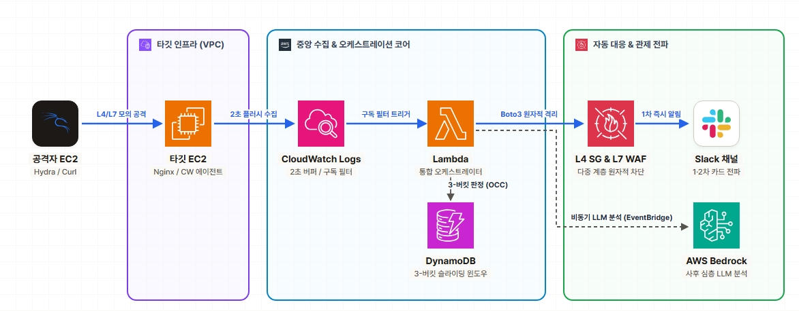
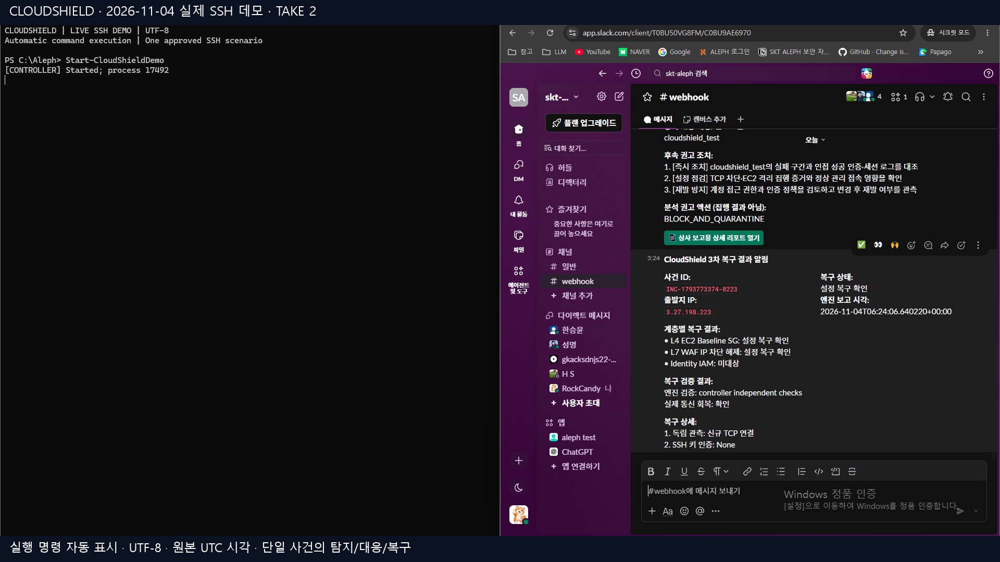
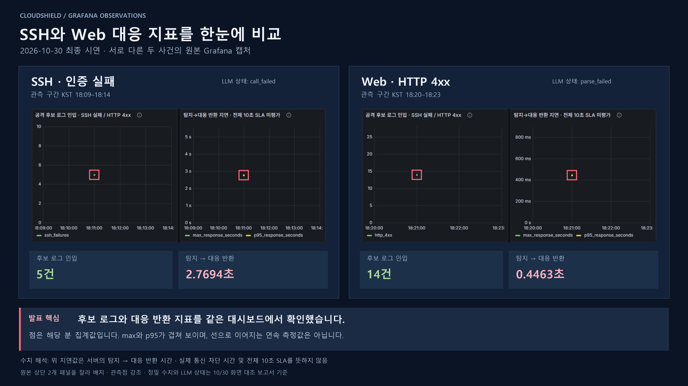
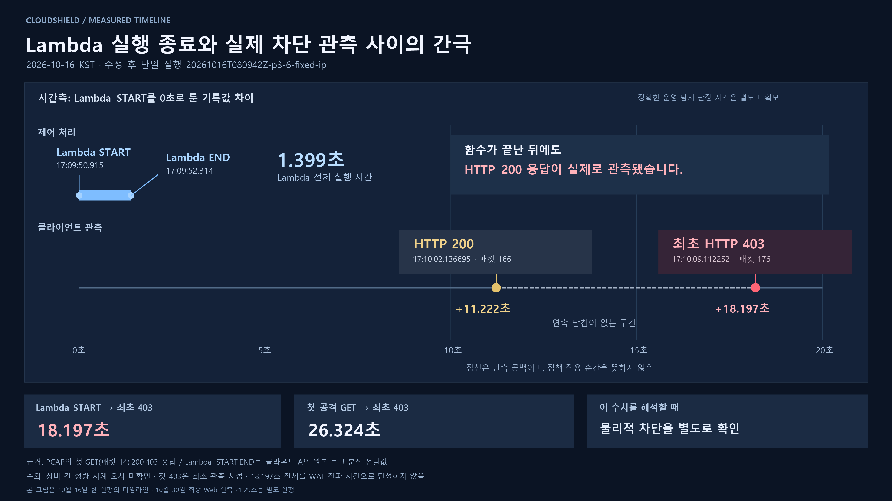
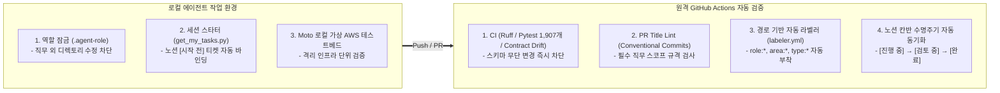

# CloudShield: Cloud Hybrid Threat Detection & Auto-Response Pipeline

<div align="center">

**클라우드 하이브리드 위협 탐지·자동 대응 및 SecOps 파이프라인**

[](https://www.python.org/)
[](https://github.com/astral-sh/ruff)
[](https://docs.pytest.org/)
[](http://docs.getmoto.org/)
[](https://trivy.dev/)
[](https://conventionalcommits.org)
[](https://app.notion.com/p/A-d5f04d37c22582ad9e7f81acd36191d0)

</div>

---

## 1. 프로젝트 개요 및 추진 배경

* **프로젝트명**: CloudShield (클라우드 하이브리드 위협 탐지·자동 대응 및 SecOps 파이프라인)
* **목표 대응 지표**: 침해 공격 인입 시 **10초 이내 자동 탐지·차단·상황 전파 완료를 목표로 설계** (Target SLA)
  - **로그 수집 (<3s) $\rightarrow$ 위험도 판정 (<5s) $\rightarrow$ 다중 계층 차단 (<2s) $\rightarrow$ 상황 전파**
* **추진 배경**:
  - **수동 침해 분석의 한계**: 클라우드 인프라 대상 무차별 대입, 비인가 디렉터리 스캐닝 등은 인입 후 수 분 내에 측면 이동으로 전이되므로 운영자의 수동 콘솔 조작만으로는 골든타임을 방어하기 어렵습니다.
  - **파이프라인 중심 엔지니어링**: 웹 UI 개발에 리소스를 분산하지 않고, **실제 인프라 라우팅, L4 패킷 플래그 분석, 정규식 ReDoS 방어 시그니처, IAM 세션 제어, DynamoDB 분산 슬라이딩 윈도우, 선언적 IaC** 등 클라우드 보안 및 플랫폼 엔지니어링 핵심 과제에 집중했습니다.

<div align="center">


*CloudShield 전역 하이브리드 침해 대응 아키텍처 토폴로지*

</div>

---

## 2. 3분 30초 관통 녹화 데모 (SSH Brute Force 대응 및 자동 복구)

발표 환경 및 네트워크 상태에 구애받지 않고 실제 패킷 단위의 차단과 알림 흐름을 증빙하기 위해 제작된 2분할 관통 실측 데모입니다. 좌측은 모의 공격 터미널의 실시간 TCP 연결 상태이며, 우측은 동일 사건 ID(`incident_id`)로 수신된 2단계 Slack 관제 알림 카드입니다.

<div align="center">

[](docs/assets/cloudshield-ssh-take2-source.mp4)

*(이미지를 클릭하면 [3분 30초 2분할 관통 데모 영상](docs/assets/cloudshield-ssh-take2-source.mp4) 원본이 재생됩니다)*

</div>

* **데모 핵심 검증 포인트**:
  1. **공격 인입 및 탐지**: Hydra SSH 공격 인입 후 서버 인증 실패 로그 중앙 수집 및 오케스트레이터 트리거.
  2. **즉각적 인바운드 드롭**: Boto3 격리 실행 직후 신규 TCP SYN 패킷에 대한 무응답 및 타임아웃 관측.
  3. **2단계 Slack 알림 전파**: 1차 실시간 격리 알림 도착 후, 백그라운드 EventBridge를 거친 2차 분석 알림 연계.
  4. **원자적 인프라 롤백**: 검증 완료 후 단일 명령으로 이전 보안 그룹 상태 원복 확인.

---

## 3. 정량 실측 성과 대시보드

CloudShield는 가정이 아닌 **실제 AWS 인프라(`ap-southeast-2`) 및 테스트베드에서 계측된 정량 데이터**를 바탕으로 시스템을 평가했습니다.

<div align="center">

| 핵심 검증 도메인 | 달성 지표 | 세부 관측 조건 및 환경 | 단일 신뢰점 원본 |
| :--- | :---: | :--- | :---: |
| **L4 인스턴스 격리 SLA** | **`5.48s`** | 서버 5회 실패 기록 후 첫 무응답 SYN 관측 (타임아웃 확인: `6.28s`) | [패킷 실측 보고서](docs/roles/network/2026-10-25-p4-3-final-showcase-verification.md) |
| **L7 WAF IPSet 차단 SLA** | **`18.20s`** | Lambda 시작부터 첫 403 응답 관측 (공격 시작 기준: `21.29s` 전파 지연) | [WAF 실측 보고서](docs/roles/network/2026-10-16-p3-6-waf-measurement.md) |
| **관제 파이프라인 반환** | **`2.70s`** | Logs Insights 탐지 $\rightarrow$ 대응 반환 시간 max/p95 지표 | [관제 패널 검증서](docs/roles/cloud-b/2026-10-30-p5-2-panel-verification.md) |
| **자동화 파이프라인 검증** | **1,907 tests** | 계약 불변식, 네트워크 패킷 덤프, 모킹 인프라 전체 테스트 통과 | [단위 테스트 슈트](tests/unit/) |
| **협업 거버넌스 안정성** | **137 PRs** | 사전 검증 하네스를 통한 137건 PR 머지 무충돌 유지 (커밋 153건) | [GitHub PR 히스토리](https://github.com/mmmphyun/aleph-project/pulls?q=is%3Apr+is%3Amerged) |
| **도메인 작업 분담률** | **30:26:23:21** | 승윤 30%, 동형 26%, 시훈 23%, 찬원 21% 균등 분담 | [노션 프로젝트 일정 DB](https://app.notion.com/p/A-d5f04d37c22582ad9e7f81acd36191d0) |

</div>

---

## 4. 프로젝트 진행 마일스톤 (Phase 1 - Phase 5 완결)

본 프로젝트는 사전 인터페이스 계약과 로컬 테스트베드를 사전에 구축하고 단계적으로 인프라를 확장하는 마일스톤 방식을 준수하여 전 과정을 완결했습니다:

- [x] **Phase 1: 개발 하네스 및 가상 테스트베드 구축 (완료)**
  - Pydantic V2 기반 불변 데이터 계약 (`src/contracts/`) 확정 및 Contract Drift Guard 검증
  - Moto 기반 가상 AWS 리소스(EC2, SG, WAFv2, DynamoDB, IAM) 테스트베드 구축
  - GitHub Actions 기반 품질 검사(Ruff, Pytest), PR 제목 린터, R&R 스코프 하드가드 구축
  - GitHub Issue/PR과 노션 칸반 보드 간 상태 및 일정 자동 동기화 배관 구축
- [x] **Phase 2: 도메인별 코어 비즈니스 로직 구현 (완료)**
  - L4 EC2 격리 및 L7 WAF IPSet 차단 Boto3 엔진 구현 (`src/remediation/remediation.py`)
  - DynamoDB 원자적 카운터 기반 5분 슬라이딩 윈도우 집계 모듈 구현 (`src/remediation/auth_window.py`)
  - 1차 시그니처 룰 및 결정론적 IncidentReport 매퍼 구현 (`src/detection/rules.py`, `src/detection/incident_mapper.py`)
  - CloudWatch Logs 페이로드 디코더 및 Slack Block Kit 전파 모듈 구현 (`src/collector/`, `src/reporter/`)
- [x] **Phase 3: AWS 실인프라 프로비저닝 및 관통 실측 (완료)**
  - VPC, EC2 타깃 서버, ALB, WAFv2, DynamoDB, Lambda Terraform 프로비저닝 완료
  - Hydra SSH 무차별 대입 및 Nginx 웹 스캐닝 모의 공격 수행
  - L4 SG 격리(5.48초) 및 L7 WAF 전파 지연(18.2초) 패킷 단위 실측 및 계층별 특성 규명
- [x] **Phase 4: 비동기 LLM 심층 분석 및 2단계 전파 배관 구축 (완료)**
  - EventBridge 기반 사후 비동기 Bedrock Claude/Nova 분석 워커 파이프라인 분리
  - 상사 보고용 3단 구조화 양식 프롬프트 엔지니어링 및 프롬프트 인젝션 방어 검증
  - Slack Block Kit 1차 실시간 격리 카드 vs 2차 사후 분석 카드 분리 전파
- [x] **Phase 5: 무상태 관제 프로비저닝 및 최종 쇼케이스 (완료)**
  - Docker Compose 기반 무상태 Grafana as Code 프로비저닝 환경 구축 (`infra/grafana/`)
  - CloudWatch Logs Insights 4사분면 관제 패널 쿼리 및 대시보드 검증
  - 3분 30초 2분할 관통 데모 영상 제작 및 캡스톤 최종 발표 완결

---

## 5. 4대 직무별 딥다이브 포트폴리오 쇼케이스

팀원 각자의 전문 영역에 따른 고유 엔지니어링 성과와 기술적 문제 해결 과정을 동등한 비중으로 상세 전개합니다.

### 5.1 클라우드 A (승윤 / [@mmmphyun](https://github.com/mmmphyun)) — 플랫폼 엔지니어 & 테크 리드

전체 인프라 오케스트레이션과 분산 데이터 일관성, 원자적 차단·복구 엔진 및 팀 개발 하네스를 전담했습니다.

* **핵심 기술 과제 및 CS 메커니즘**:
  1. **무상태 컨테이너 환경의 슬라이딩 윈도우 알고리즘 진화**:
     - *문제 정의*: Lambda는 무상태 컨테이너이므로 호출 간 공격 상태를 메모리에 유지할 수 없으며, 분 경계면(11:59 vs 12:01)에 걸쳐 인입되는 공격이 분할되어 탐지 임계치를 누락하는 결함 식별.
     - *알고리즘 및 서버리스 트레이드오프*: 상시 인스턴스 비용을 배제하고 유휴 비용 0원의 무상태 서버리스 구조를 유지하기 위해 DynamoDB 온디맨드를 채택. Cloudflare 가중 알고리즘의 저트래픽 오차를 극복하기 위해 분 단위 버킷 기반 **'타임스탬프 3-버킷 슬라이딩 윈도우'**를 설계하여 경계면 누락을 방어.
     - *분산 일관성 모델 보장*: 쓰기 직후 후속 배치가 즉시 읽어야 하는 파이프라인 특성상 DynamoDB의 최종 일관성으로 인한 카운트 누락을 방어하기 위해 **`ConsistentRead=True`(Strongly Consistent Read)**를 강제 적용.
  2. **Boto3 기반 원자적 차단 및 단일 명령 롤백 엔진**:
     - 단일 API 호출(`modify_instance_attribute`)을 통해 침해 인스턴스의 보안 그룹을 격리 SG로 원자적 교체하고, ALB 전면 WAF IPSet에 `/32` 단위 차단을 등록하는 멱등성 엔진 구축.
     - 관통 실측 후 테스트베드를 즉시 정상화할 수 있는 L4/L7 통합 원자적 롤백 복구 모듈 개발.
     - SQS 완충 큐에 따른 1-3초의 폴링 큐잉 지연을 배제하고 10초 SLA를 엄수하기 위해 Subscription Filter 동기 직접 트리거를 채택했으며, 프로덕션 동시성 고갈을 방어하는 Lambda 예약 동시성 설계를 병행.
  3. **컴파일 타임 계약 하드가드 및 무상태 관제 프로비저닝**:
     - Pydantic V2 불변 모델을 수립하고, 4개 직무 간 모의 데이터 불일치를 선제 방어하는 [5대 교차 계약 테스트](tests/test_contracts.py) 구축.
     - Grafana 웹 UI 수동 조작을 배제하고 설정 파일(`cloudwatch.yaml`, `dashboards.yaml`) 주입으로 일관된 동일 관제 환경을 재현하는 **Grafana as Code** 환경 구축.

<div align="center">

| 담당 영역 | 세부 구현 모듈 | 핵심 엔지니어링 원리 | 상세 기술 문서 |
| :--- | :--- | :--- | :---: |
| **분산 윈도우** | `src/remediation/auth_window.py` | DynamoDB 원자적 카운터, 3-버킷 쿼리, Strongly Consistent Read | [윈도우 아키텍처](docs/roles/cloud-a/2026-09-21-auth-failure-window-architecture.md) |
| **차단/복구 엔진** | `src/remediation/remediation.py` | Boto3 다중 계층 원자적 차단, ClientError 정밀 처리, 멱등 롤백 | [L4/L7 차단 명세](docs/roles/cloud-a/2026-09-10-l4-ec2-quarantine-architecture.md) |
| **비동기 오케스트레이터** | `src/remediation/orchestrator.py` | 실시간 차단-사후 분석 분리, EventBridge 비동기 격리 파이프라인 | [오케스트레이터 분석](docs/roles/cloud-a/2026-10-21-orchestrator-putevents-worker.md) |
| **관제 프로비저닝** | `infra/grafana/docker-compose.yml` | Zero-Click 무상태 프로비저닝, 불변 UID 바인딩, 최소 권한 IAM | [Grafana 배포 보고서](docs/roles/cloud-a/2026-10-28-p5-1-pipeline-deploy-and-grafana-provisioning.md) |

</div>

> **클라우드 A 독립 기술 포트폴리오**: [docs/roles/cloud-a/README.md](docs/roles/cloud-a/README.md) (총 14편의 아키텍처 및 실측 보고서 수록)

---

### 5.2 보안 (찬원 / [@gkacksdnjs22-stack](https://github.com/gkacksdnjs22-stack)) — 침해 탐지 및 보안 인텔리전스 엔지니어

시그니처 기반 침해 탐지 룰, MITRE ATT&CK TTP 매핑, ReDoS 방어 및 사후 LLM 분석 인텔리전스를 전담했습니다.

* **핵심 기술 과제 및 CS 메커니즘**:
  1. **정규식 시그니처 엔진의 ReDoS(Catastrophic Backtracking) 방어**:
     - *문제 정의*: 대규모 로그 인입 시 악의적인 패턴이나 긴 문자열이 유입되면 정규식 엔진의 지수 시간 복잡도($O(2^n)$) 역추적으로 인해 Lambda CPU가 포화되는 취약점 식별.
     - *해결책*: 과도한 탐색을 유발하는 중첩 수량자(`(a+)+`)를 전면 배제하고, 원자적 그룹 및 토큰화 기반의 $O(n)$ 선형 시간 탐색 구조로 정규식을 설계하여 ReDoS 위협 방어.
  2. **10초 실시간 경로와 사후 비동기 LLM 파이프라인의 아키텍처적 분리**:
     - *설계 결단*: 실시간 차단 경로에 외부 LLM API(Bedrock)를 동기 호출할 경우 네트워크 왕복 시간과 토큰 생성 지연으로 10초 SLA 달성이 불가능함을 식별.
     - *분리 구조 및 역할 정의*: 단순 침해 팩트 정형 요약은 로컬 매퍼(incident_mapper.py)가 1ms 내에 (1) 완결하고, 고비용 LLM은 웹 비인가 URI의 난독화 페이로드 의도 분석 및 권고 추론이라는 비정형 인텔리전스에 한정 투입하여 차단 골든타임을 확보.
  3. **상사 보고용 3단 양식 프롬프트 엔지니어링 및 프롬프트 인젝션 방어**:
     - 관측된 공격 사실만을 엄격히 전달하기 위해 `[1. 침해 개요]`, `[2. 관측 로그 근거]`, `[3. 영향도 및 침해 판정]` 및 3대 권고(`[즉시 조치]`, `[설정 점검]`, `[재발 방지]`) 구조화 양식 설계.
     - 공격자가 SSH 계정명이나 Web URI에 시스템 명령이나 탈옥 구문을 삽입하더라도 보고서의 핵심 필드(IP, 타깃, 차단 액션)가 변조되지 않도록 **보호 필드 불변성 검증 파서**를 구축하고, Bedrock 호출 실패 시 원본 보고서를 보존하는 **15건의 Fallback 고정 평가셋 회귀 검증** 완료.

<div align="center">

| 담당 영역 | 세부 구현 모듈 | 핵심 엔지니어링 원리 | 상세 기술 문서 |
| :--- | :--- | :--- | :---: |
| **탐지 룰 엔진** | `src/detection/rules.py` | ReDoS $O(n)$ 방어 정규식, MITRE ATT&CK T1110/T1595 1:1 매핑 | [ReDoS 설계서](docs/roles/security/2026-09-29-web-l7-signature-redos-design.md) |
| **침해사고 매퍼** | `src/detection/incident_mapper.py` | 결정론적 IncidentReport 생성, 외부 API 제로화, 필드 불변성 | [매퍼 아키텍처](docs/roles/security/2026-09-11-mitre-incident-report.md) |
| **LLM 프롬프트/파서** | `src/detection/llm_deep_analyzer.py` | 3단 상사 보고 양식, 프롬프트 인젝션 방어, 비표시 제어문자 가시화 | [3단 프롬프트 설계서](docs/roles/security/2026-10-28-executive-llm-report-and-eval.md) |
| **장애 회귀 검증** | `tests/unit/test_incident_mapper.py` | Bedrock 장애 시 Fallback 고정 평가셋 15건 불변성 검증 | [LLM 검수 보고서](docs/roles/security/2026-10-30-p5-3-llm-executive-report-evaluation.md) |

</div>

> **보안 독립 기술 포트폴리오**: [docs/roles/security/README.md](docs/roles/security/README.md) (총 10편의 시그니처 및 LLM 분석 보고서 수록)

---

### 5.3 클라우드 B (시훈 / [@wkdtlgns99-cell](https://github.com/wkdtlgns99-cell)) — 클라우드 시스템 및 SRE 관제 엔지니어

타깃 서버 로깅 인프라, 이종 로그 스트림 라우팅, 2단계 Slack 관제 알림 및 Grafana 4사분면 모니터링을 전담했습니다.

* **핵심 기술 과제 및 CS 메커니즘**:
  1. **CloudWatch Agent 중앙 로깅 튜닝 및 수집 버퍼 최적화**:
     - *문제 정의*: CloudWatch Agent의 기본 로그 플러시 대기 시간으로 인해 공격 로그 전송이 수 분간 지연되어 실시간 파이프라인이 마비되는 현상 발생.
     - *해결책 및 TCO 고려*: 타깃 EC2 인스턴스의 수집 버퍼 플러시 주기를 **2초**로 정밀 튜닝하여 파이프라인의 이론적 최소 지연 한계를 실측. 대규모 프로덕션 확장 시 PutLogEvents API 비용 및 스로틀링을 완화하기 위한 Kinesis Firehose / Fluent Bit 버퍼링 연계 아키텍처 도출.
  2. **이종 로그 스트림 역직렬화 어댑터 및 인메모리 중복 제거**:
     - 단일 Lambda 오케스트레이터가 서로 다른 규격의 로그(Syslog vs Nginx Combined)를 처리할 수 있도록 Base64 디코딩 및 Gzip 압축 해제 파이프라인 구축.
     - 로그 그룹 경로에 따라 이벤트를 분기하고, 이벤트 ID 해시 집합을 기반으로 배치 내 중복 로그를 인메모리에서 사전 필터링하는 정형화 어댑터 구현.
  3. **지시 조치와 엔진 반환값을 분리한 Slack Block Kit 2단계 알림**:
     - *운영자 혼선 방지*: "차단 지시"와 실제 Boto3 엔진이 반환한 "실제 인프라 집행 상태(성공·실패·미완료·미대상)"를 엄격히 분리 표기하여 오판 방지.
     - *2단계 전파*: 1차 실시간 격리 알림 카드 발송 후, 심층 분석이 완료되면 동일한 `incident_id`를 갖는 2차 분석 카드를 연계 발송.
     - *장애 및 인젝션 격리*: 제어 문자 이스케이프를 적용해 공격 문자열에 의한 의도치 않은 슬랙 멘션(@here, @channel) 공격을 방어하고, SaaS 네트워크 순단에 대비한 타임아웃 예외 처리 적용.
  4. **Grafana 4사분면 CloudWatch Logs Insights 관제 대시보드 설계**:
     - 공격 인입 건수, 10초 SLA 대응 소요 시간(max/p95 2.7042s), LLM 정상/Fallback 전환율, 8단계 사건 처리 타임라인을 코드로 시각화.

<div align="center">


*CloudShield Grafana 4사분면 SecOps 관제 대시보드 실측 화면*

</div>

<div align="center">

| 담당 영역 | 세부 구현 모듈 | 핵심 엔지니어링 원리 | 상세 기술 문서 |
| :--- | :--- | :--- | :---: |
| **중앙 로깅 인프라** | `amazon-cloudwatch-agent.json` | 버퍼 플러시 2초 최적화, 다중 로그 스트림 수집 | [수집 레이턴시 보고서](docs/roles/cloud-b/2026-10-08-cloudwatch-collection-latency-report.md) |
| **로그 정형화 라우터** | `src/collector/cw_processor.py` | Base64/Gzip 역직렬화, LogGroup 분기, 인메모리 중복 제거 | [스트림 라우터 명세](docs/roles/cloud-b/2026-09-29-nginx-payload-decoder-and-multistream-router.md) |
| **관제 알림 렌더러** | `src/reporter/slack_notifier.py` | Block Kit 2단계 알림, 집행 상태 분리 표기, 멘션 인젝션 방어 | [Slack 2단계 실측서](docs/roles/cloud-b/2026-10-23-p4-2-slack-sequential-measurement.md) |
| **SecOps 대시보드** | `docs/roles/cloud-b/grafana/p5-2.json` | 4사분면 Logs Insights 쿼리, SLA 2.7042s 관측, 사건 타임라인 추적 | [Grafana 쿼리 대조서](docs/roles/cloud-b/2026-10-30-p5-2-panel-verification.md) |

</div>

> **클라우드 B 독립 기술 포트폴리오**: [docs/roles/cloud-b/README.md](docs/roles/cloud-b/README.md) (총 18편의 로깅 및 관제 보고서 수록)

---

### 5.4 네트워크 (동형 / [@RockCandy444](https://github.com/RockCandy444)) — 모의 침투 및 네트워크 검증 엔지니어

모의 공격 시뮬레이션 환경 구축, Wireshark/tcpdump L4 패킷 플래그 분석, L4/L7 전파 지연 실측 및 한계 규명을 전담했습니다.

* **핵심 기술 과제 및 CS 메커니즘**:
  1. **모의 공격 재현 환경 구축 및 매초 신규 TCP 연결 계측**:
     - 단순 기존 SSH 세션 유지 여부로 차단을 판정하는 결함을 배제하기 위해, **매초 새로운 TCP 3-Way Handshake를 능동 시도하는 계측기(`ec2_hydra_measurement.py`)** 구현.
     - Hydra SSH 무차별 대입 공격 및 curl 기반 웹 비인가 디렉터리 스캔 환경을 격리 노드에서 구성.
  2. **Wireshark/tcpdump L4 TCP 패킷 플래그 정밀 분석**:
     - *정상 구간*: 공격 인입 초기 클라이언트 SYN $\rightarrow$ 타깃 SYN-ACK $\rightarrow$ 클라이언트 ACK 정상 수립 관측.
     - *차단 구간*: L4 보안 그룹 교체 집행 후, **36개 연속 신규 SYN 패킷에 대해 타깃 서버가 아무런 응답을 주지 않고(무응답) 클라이언트 타임아웃으로 드롭되는 패킷 흐름 입증**.
  3. **제어 평면과 데이터 평면의 전파 지연 간극 실측 규명**:
     - *문제 발견*: Lambda 차단 API(Boto3) 호출은 1.40초 만에 종료되었으나, 실제 데이터 평면에서는 이후에도 HTTP 200 통신이 지속되는 현상 관측.
     - *원인 분석*: API 반환(제어 평면)과 AWS WAF 글로벌/리전 배포망에 IP 차단 룰이 동기화되는 시점(데이터 평면) 간에 물리적 전파 지연이 존재함을 패킷으로 규명.
  4. **L4 SG vs L7 WAF 계층별 트레이드오프 및 솔직한 한계 공유**:
     - *L4 Security Group*: 서버 5회 실패 후 **5.48초 만에 신규 SYN이 즉각 드롭**되었으나, 인스턴스 전체 포트를 제한하여 정상 서비스에 영향을 미칠 수 있는 광범위 격리 특성을 가집니다.
     - *L7 AWS WAF*: 공격자 IP만 선별 차단하지만 Lambda 시작부터 첫 403 응답까지 **18.20초**(첫 공격 기준 **21.29초**)가 소요되어 10초 SLA에는 미달함을 투명하게 규명했습니다.
     - *상호 보완성 및 가용성 부수 효과 방어*: L4 SG 격리는 정상 사용자 통신까지 중단되는 가용성 부수 효과가 따르므로, 대민 서비스는 L7 WAF IPSet 선별 차단을 1차 방어선으로 두고 L4 SG는 호스트 침해 시 인스턴스를 즉각 분리하는 최후의 비상 차단으로 역할을 분리하여 상호 보완하도록 설계.

<div align="center">


*제어 평면 API 성공과 데이터 평면 실제 403 차단 간의 전파 지연 워터폴 타임라인*

</div>

<div align="center">

| 담당 영역 | 세부 구현 모듈 | 핵심 엔지니어링 원리 | 상세 기술 문서 |
| :--- | :--- | :--- | :---: |
| **공격 시뮬레이션** | `network/attack_simulation.sh` | Hydra 9.2 자동화, 합성 계정 오답 주입, 안전성 플래그 적용 | [모의 공격 가이드](docs/roles/network/demo-attack-runner.md) |
| **패킷 계측기** | `network/ec2_hydra_measurement.py` | 매초 신규 TCP SYN 탐침, tcpdump 패킷 캡처, TShark 분석 | [타임라인 텔레메트리](docs/roles/network/roundtrip-timeline-telemetry.md) |
| **L4 패킷 분석** | `tests/unit/test_network.py` | 3-Way Handshake 수립 $\rightarrow$ 격리 후 36개 SYN 무응답 분석 | [L4 패킷 분석서](docs/roles/network/2026-10-25-p4-3-final-showcase-verification.md) |
| **전파 지연 규명** | `network/waf_packet_measurement.py` | 제어 API(1.4s) vs 실제 데이터 평면 차단(18.2s/21.29s) 분리 규명 | [L4 vs L7 지연 분석](docs/roles/network/2026-10-21-l4-vs-l7-propagation-latency-analysis.md) |

</div>

> **네트워크 독립 기술 포트폴리오**: [docs/roles/network/README.md](docs/roles/network/README.md) (총 16편의 모의 침투 및 패킷 분석 보고서 수록)

---

## 6. 플랫폼 엔지니어링 기반 R&R 분업 및 팀 거버넌스 체계

CloudShield는 4인이 각자의 도메인 로직에 깊이 몰입할 수 있도록 **플랫폼 엔지니어링 선행 투자 모델**을 적용하여 팀을 운영했습니다.



### 6.1 플랫폼 엔지니어링 기반 작업 분담 구조
* **도메인 엔지니어의 인지 부하 최소화**:
  - 네트워크, 보안, 클라우드 B 팀원이 환경 설정, 배포 배관, Git 충돌, AWS 과금 등 인프라 부하 없이 고유 도메인 연구에만 집중할 수 있도록 플랫폼 엔지니어가 CI/CD 하네스, Pydantic V2 계약 인터페이스, Moto 모킹 테스트베드를 선제 구축했습니다.
* **커밋 단위의 직무별 특성**:
  - 도메인 팀원은 패킷 덤프 분석, 시그니처 룰 검증, Grafana 대시보드 등 장기간의 연구를 거친 대형 기능 단위 압축 커밋을 발행했습니다.
  - 플랫폼 엔지니어는 GitHub Actions 러너 튜닝, 라벨러, 테스트베드 픽스처 확장 등 인프라 배관을 세밀하게 분할 검증하는 원자적 커밋 빈도가 높았습니다.
* **파이프라인 수호를 위한 Fast-Track 핫픽스 단일화**:
  - 팀 헌법(`AGENTS.md` 4.5절)에 따라 4인 병렬 개발 환경에서 공통 배관 장애 발생 시 스키마 오염을 방지하기 위해 `hotfix` 권한을 테크 리드 단일 창구로 제한 운영했습니다.
* **실제 비즈니스 요구사항 분담 증빙**:
  - [공식 노션 프로젝트 일정 DB](https://app.notion.com/p/A-d5f04d37c22582ad9e7f81acd36191d0)의 100개 작업 카드 기준 실질 분담률은 **승윤 30%, 동형 26%, 시훈 23%, 찬원 21%**로 4개 직무가 대등하게 마일스톤을 책임졌습니다.

---

## 7. 실증 침해 시나리오 2종 비교

<div align="center">

| 구분 | [시나리오 1] SSH Brute Force (L4 대응) | [시나리오 2] Web L7 Directory Scanning (L7 대응) |
| :--- | :--- | :--- |
| **공격 도구** | Hydra 9.2 (`network/attack_simulation.sh`) | Curl, Gobuster, Nikto |
| **인입 경로** | SSH 포트(TCP 22) 패스워드 무차별 대입 | Web HTTP/HTTPS(80/443) 비인가 디렉터리 경로 탐색 |
| **타깃 로그** | `/var/log/auth.log` (`SyslogAuthEvent`) | `/var/log/nginx/access.log` (`NginxAccessLogEvent`) |
| **1차 탐지 룰** | 동일 IP 기준 5분 내 5회 이상 인증 실패 / 다중 계정 스프레잉 | 짧은 시간 내 비인가 URL 패턴 탐색 및 401/403/404 임계치 초과 |
| **MITRE ATT&CK** | `T1110.001` (Brute Force: Password Guessing) | `T1110.003` (Password Spraying), `T1595.002` (Active Scanning) |
| **차단 조치** | **L4 EC2 Quarantine SG 단독 원자적 교체** | **L7 AWS WAF IPSet `/32` 인바운드 차단 등록** |
| **실측 소요 지연** | **`5.48s`** (서버 5회 실패 후 첫 무응답 SYN) | **`18.20s`** (Lambda 시작 후 첫 403 응답 / 전파 지연 관측) |
| **전파 채널** | Slack Block Kit (`quarantine_applied: true`, MITRE ID) | Slack Block Kit (`waf_blocked: true`, 공격자 IP/32) |
| **복구 절차** | `restore_baseline_sg.py` (단일 명령 기준 SG 원복) | `unblock_waf_ip.py` (WAF IPSet 공격자 IP 삭제) |

</div>

---

## 8. 로컬 검증 및 실행 가이드

모든 커밋과 PR은 단일 검증 스크립트를 통해 품질 게이트를 통과해야 합니다.

### 8.1 로컬 품질 게이트 일괄 실행
```powershell
# R&R 도메인 경계선, Ruff Lint, Ruff Format, Pytest 1,907개 일괄 검증
powershell .\scripts\check.ps1
```

### 8.2 무상태 Grafana 관제 대시보드 기동
```powershell
# 1. 관리자 비밀번호 환경변수 설정
$env:GRAFANA_ADMIN_PASSWORD = "YourSecurePassword123!"

# 2. Docker Compose로 무상태 Grafana 기동 (127.0.0.1:3000 바인딩)
docker compose -f infra/grafana/docker-compose.yml up -d

# 3. 브라우저 접속: http://127.0.0.1:3000 (cloudshield-cloudwatch 데이터소스 자동 로드)
```

---

## 9. 주요 문서 및 외부 링크 네비게이션 허브

<div align="center">

| 구분 | 주요 문서 / 산출물 | 설명 및 바로가기 링크 |
| :--- | :--- | :---: |
| **공식 노션 워크스페이스** | 노션 칸반 보드 및 일일 스크럼 회의록 | [공식 노션 페이지 바로가기 ↗](https://app.notion.com/p/A-d5f04d37c22582ad9e7f81acd36191d0) |
| **최종 발표 슬라이드** | 독립형 로컬 구동 HTML 프레젠테이션 | [최종 발표 슬라이드덱](docs/assets/presentation_standalone.html) |
| **중간 발표 슬라이드** | 중간 주제 발표자료 HTML | [중간 발표 슬라이드덱](docs/assets/index_midterm.html) |
| **종합 보고서** | CloudShield 프로젝트 종합 상세 보고서 | [프로젝트 종합 보고서](docs/assets/CloudShield_보고서.html) |
| **데모 비디오** | 3분 30초 2분할 SSH 관통 대응 및 복구 녹화본 | [3분 30초 데모 비디오 (MP4)](docs/assets/cloudshield-ssh-take2-source.mp4) |
| **플랫폼 포트폴리오** | 클라우드 A (승윤) 기술 포트폴리오 | [클라우드 A 기술 포트폴리오](docs/roles/cloud-a/README.md) |
| **보안 포트폴리오** | 보안 (찬원) 기술 포트폴리오 | [보안 기술 포트폴리오](docs/roles/security/README.md) |
| **관제 포트폴리오** | 클라우드 B (시훈) 기술 포트폴리오 | [클라우드 B 기술 포트폴리오](docs/roles/cloud-b/README.md) |
| **네트워크 포트폴리오** | 네트워크 (동형) 기술 포트폴리오 | [네트워크 기술 포트폴리오](docs/roles/network/README.md) |
| **팀 프로젝트 헌법** | AI 코딩 에이전트 작업 지침 | [AGENTS.md](AGENTS.md) |
| **기여 가이드** | 프로젝트 기여 및 Git 협업 컨벤션 | [CONTRIBUTING.md](CONTRIBUTING.md) |

</div>
