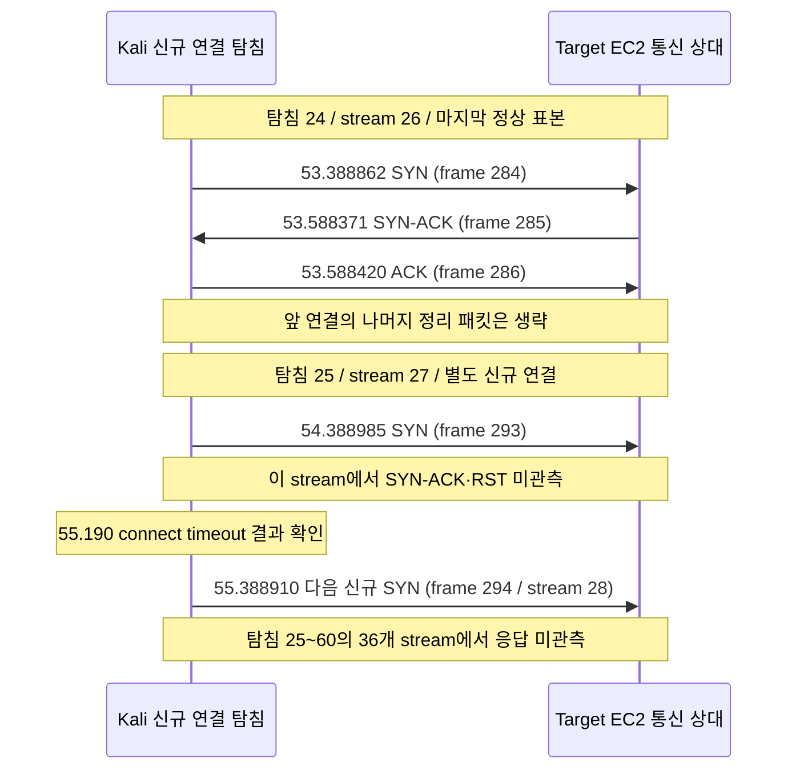
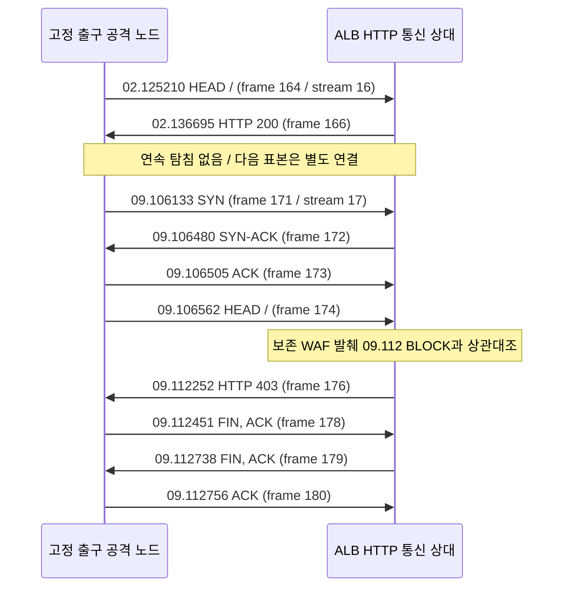

# L4 SG 격리와 L7 리전 WAF의 차단 관측 지연 비교

- 작성일: **2026-10-20 KST**
- 실측일: **2026-10-14(L4), 2026-10-16(L7) KST**. 이번 작업은 기존 증거의 오프라인 분석이며 새 실측이 아니다.
- 파일명 날짜 `2026-10-21`은 노션 카드의 산출물 명세를 유지한 식별자이며 작성일·실측일이 아니다.
- 담당: 네트워크 `@RockCandy444`
- [Notion Task](https://notion.so/3fe04d37c2258004beddc2dff4b4ac97) · [GitHub Issue #203](https://github.com/mmmphyun/aleph-project/issues/203)
- 브랜치: `docs/network-p4-l4-vs-l7-latency-analysis` · 분석 기준 main: `bc4a7d0`

## 1. 목적과 핵심 결과

카드의 “L4 하이퍼바이저 5.48초 대 L7 WAF 엣지 18.2초”가 가리키는 사건을 먼저 확인한다. **두 값은 같은 기준의 정책 전파 성능이 아니다.** L4의 약 5.478초는 서버 실패 5회 누적 기록부터 최초 무응답 탐침 SYN 송신까지이고, L7의 약 18.197초는 Lambda START부터 최초 HTTP 403 응답 수신까지다. 두 값으로 속도 배수나 우열을 계산하지 않는다.

| 구분 | 확인된 사실 또는 계산 | 비교 가능한 범위 |
| --- | --- | --- |
| L4 신규 연결 | 24회 연결 성공 뒤 36회 연속 connect timeout. 해당 36 stream에는 SYN만 있고 SYN-ACK·RST가 없음 | 새로운 TCP 연결의 무응답 전환. 기존 Established SSH 세션 종료는 미측정 |
| L7 요청 | 최종 실행 GET 15건에는 403이 없고, 사후 HEAD 3건에서 403 관측. 보존 WAF 발췌에도 같은 출발지·HEAD·시각의 BLOCK 3건 존재 | TCP 연결 수립 뒤 HTTP 요청 거부. 패킷 관측과 WAF의 종결 동작을 구분해 상관대조 |
| 제어 처리 | L4 SG 부착 확인 뒤에도 성공 SYN 탐침이 존재. L7 Lambda 종료 뒤에도 HEAD 200과 WAF ALLOW가 존재 | 제어 처리·조회 완료만으로 데이터 경로 차단 완료를 선언할 수 없음 |
| 공격 시작 기준 | L4 첫 SYN→최초 무응답 SYN 23.936051초, L7 첫 GET→최초 403 26.324311초 | 두 실행 모두 이 관측 종료점까지 10초 초과. SYN과 GET의 의미 차이 때문에 동일 조건의 성능 비교는 아님 |
| 임계치 이후 기준 | L4 실패 5회 기록→최초 무응답 SYN 5.477985초. L7의 정확한 운영 탐지 판정 시각은 미확보 | L4는 전달 시각 기준 10초 이내라는 제한된 결과. L7을 같은 임계치 기준으로 수치 비교할 수 없음 |

**기술적 결론:** 서로 다른 차단 계층의 관측 결과와 제어 처리 이후의 간극은 확인된다. 전체 10초 SLA, 모든 경로의 전파 완료, AWS 서비스의 일반 성능은 이 단일 실행 쌍으로 입증되지 않는다. 카드의 “하이퍼바이저”·“엣지” 표현은 6절의 공식 동작과 실제 배치 범위에 맞춰 검토한다.

## 2. 실행·자료 범위와 증거 수준

### 2.1 실행 분리

| 자료 | 실행 ID / 날짜 | 결과와 사용 범위 |
| --- | --- | --- |
| [L4 재실측 N1](2026-10-14-p3-3c-hydra-l4-remeasurement.md) | `20261014T044730Z-ced8779f` / 10월 14일 | 주 비교 대상. Kali WSL2→승인 EC2 TCP 22. 실패 5건은 A/B 전달 기록, 신규 연결 무응답은 로컬 증거 |
| [WAF 초회 N2](2026-10-16-p3-6-waf-measurement.md) | `20261016T065016Z-p3-6` / 10월 16일 | 모바일 출구 분산과 입력 계약 `extractedFields` 오류. B 확인상 탐지 전 중단·WAF ALLOW. 지연이 긴 성공 실행으로 취급하지 않음 |
| [고정 IP 재실측 N3](2026-10-16-p3-6-fixed-ip-retest.md) | `20261016T075925Z-p3-6-fixed-ip` / 10월 16일 | Web 탐지 후 `GetWebACLForResource` 권한 오류, IPSet 등록 전 실패. 사후 HEAD도 200, 403 없음 |
| [최종 403 재실측 N4](2026-10-16-p3-6-waf-403-retest.md) | `20261016T080942Z-p3-6-fixed-ip` / 10월 16일 | 주 비교 대상. 고정 출구 Ubuntu 노드→승인 시드니 ALB HTTP 80. 18.197초의 출처 |
| [통합 러너 N5](demo-attack-runner.md) | 별도 구현·모의 검증 문서 | 기존 관측값과 계측 의미를 설명하는 참고. 러너의 mock 성공을 실인프라 증거로 사용하지 않음 |

N2의 입력 계약 장애, N3의 IAM 장애, N4의 HTTP 응답 전환을 한 실행의 타임라인으로 합치지 않는다. 초회 보고서만으로 18.2초를 도출할 수 없다. N4의 출발지 고정은 N2와의 환경 차이이므로 세 실행을 반복 측정 표본으로 평균내지 않는다.

### 2.2 출처 구분

| 증거 수준 | 이번에 실제 읽은 자료 | 확정할 수 없는 범위 |
| --- | --- | --- |
| 로컬 원본·파생 관측 | N1의 Kali 보존 PCAP·manifest·CSV 해시 및 선택 패킷 행, N2~N4의 로컬 manifest·PCAP 해시, N4 HTTP/TCP 파생 CSV와 요청별 시각 | 클라이언트 캡처만으로 서버 내부 판정·SG 드롭 위치를 직접 확인할 수 없음 |
| 담당자 전달값 | N1/N4의 A/B 시각, Lambda RequestId·START/END, SG 확인·IPSet 완료 설명 | 이번 작업에서 Lambda·EC2·IPSet AWS 원본을 직접 조회하거나 확보한 것이 아님 |
| 보존 AWS 로그 발췌 | [보안 평가 S1](../security/2026-10-19-p3-8-waf-log-evaluation.md)의 [WAF 선택 20건](../security/evidence/p3-8-2026-10-16/waf-selected-events.json), [Nginx 선택 16건](../security/evidence/p3-8-2026-10-16/nginx-attacker-events.json), [출처 manifest](../security/evidence/p3-8-2026-10-16/manifest.json) | 보안 담당이 받은 원본에서 선택한 필드와 원본 좌표다. 전체 AWS API 응답·전체 페이지를 이번에 확보했다는 의미가 아님 |
| 담당자 원본 분석 보고 | [클라우드 B L4 B1](../cloud-b/2026-10-14-p3-4-incident-measurement.md), [L7 B2](../cloud-b/2026-10-16-p3-7-nginx-waf-measurement.md), [클라우드 A L4 A1](../cloud-a/2026-10-14-p3-3b-baseline-sg-ingress-rollback-report.md) | 문서의 당시 확인 범위·전달값·정밀도 차이를 유지. B2의 합성 수집 지연을 실측값으로 사용하지 않음 |

S1은 N4의 WAF 공격자 20건을 ALLOW 17·BLOCK 3으로 집계했다. Nginx 16건과의 차이는 `/health` 로깅 제외 1건과 WAF에서 차단한 HEAD 3건으로 설명되며, 남은 16건의 IP·메서드·URI·초 단위 시각 튜플이 대응한다. 공통 요청 ID가 없어 정확한 요청 ID 조인은 아니다. N3의 서버 로그 19건과 클라이언트 20쌍 차이는 N3에 남은 별도 미확인 사항이며 N4의 대조 결과로 소급 해결하지 않는다.

## 3. 실행별 사건 타임라인

아래 시각은 각 표에 표시한 날짜의 KST(UTC+09:00)다. PCAP epoch는 UTC 기준으로 대조했다. 본문의 소수점 3자리는 읽기용 기록 해상도이며 절대 정확도 보장이 아니다. 초 단위 원본에는 `.000`을 붙여 밀리초 관측처럼 표현하지 않는다.

다음은 소수점 3자리로 반올림한 읽기용 병렬표다. 같은 행이 동일 의미의 성능 지표라는 뜻은 아니며, 산식은 아래 상세 원시각을 사용한다.

| 사건 | N1 L4 / 10월 14일 KST | N4 L7 / 10월 16일 KST |
| --- | --- | --- |
| 공격 측 시작 표본 | 13:47:30.453, Hydra 첫 SYN | 17:09:42.788, 첫 GET 송신 |
| 탐지 조건 관련 기록 | 13:47:48.911, 5회차 실패 CW timestamp | 17:09:48, 초 단위 Nginx `/backup`; 정확한 운영 판정 시각 아님 |
| Lambda START | 13:47:50.994 | 17:09:50.915 |
| 제어 측 확인 전달값 | 13:47:52.500, SG 확인 | 17:09:52, 초 단위 IPSet 완료 |
| 마지막 정상 표본 | 13:47:53.389, 성공 탐침 SYN | 17:10:02.137, HEAD 200 응답 |
| 최초 차단 후보 | 13:47:54.389, 무응답 탐침 SYN | 17:10:09.112, HEAD 403 응답 |
| 클라이언트 결과 확인 | 13:47:55.190, timeout | 17:10:09.112, HTTP 응답 |

### 3.1 L4 — 2026-10-14, N1

| 사건 | KST 시각 | 근거·해상도 / 주의 |
| --- | --- | --- |
| 정상 기준선 SYN→SYN-ACK→ACK | 13:47:30.188329 → .387705 → .387744 | CSV frames 1~3, 마이크로초 기록 |
| Hydra 호출 직전 | 13:47:30.388 | manifest `hydra.started_at`, 밀리초. 첫 패킷과 구분 |
| Hydra 첫 SYN | 13:47:30.452934 | frame 6, 모듈 준비 연결. 인증 연결의 SYN은 13:47:32.169043 |
| 5번째 서버 인증 실패 기록 | 13:47:48.911 | B가 확인한 CW 이벤트 timestamp 전달값, 밀리초. 운영 판정 함수의 실행 시각은 아님 |
| 해당 실패 CW 수집 | 13:47:50.853 | B의 ingestionTime 전달값, 밀리초 |
| Lambda START | 13:47:50.994 | B 보고, RequestId `4557b25c-3a8f-4463-b908-078578d9f282`. incident_id 직접 연결은 미확보 |
| 격리 SG 부착 확인 | 13:47:52.500 | A의 교체 검증 전달값. API 요청 시작·응답 완료의 별도 원본 시각은 없음 |
| 마지막 성공 탐침 SYN / SYN-ACK / ACK | 13:47:53.388862 / .588371 / .588420 | frames 284~286, stream 26, 탐침 24 |
| Slack 게시 | 13:47:54.092879 | B 전달 메시지 ts `1791953274.092879`. 사용자 클라이언트 수신은 미측정 |
| Lambda END/REPORT | 13:47:54.216 | B 보고. START~END 벽시계 차 3.222초와 REPORT Duration 3221.18ms는 구분 |
| 최초 무응답 탐침 SYN | 13:47:54.388985 | frame 293, stream 27, 탐침 25. 이 시점에 실패 결과를 이미 알았다는 의미는 아님 |
| 최초 timeout 확인 | 13:47:55.190 | manifest 탐침 25 `ended_at`, 0.8초 connect 제한 뒤 결과 |
| 마지막 무응답 SYN | 13:48:29.388828 | frame 328, 탐침 60. 후반 36개 신규 stream의 SYN에 응답 없음 |
| Baseline SG 복구 완료 | 13:52:28.594 | A 전달값 |
| Kali TCP 22 재연결 확인 완료 | 14:35:23.944 | 로컬 복구 확인 JSON. 복구 API 완료 시각과 별개 |

확인된 무응답은 **신규 연결**에 한정한다. 전체 캡처의 RST 50개는 앞선 짧은 성공 탐침 연결 정리에서 관측됐으며 차단 시점 RST로 재분류하지 않는다. 0.8초 제한의 무응답 탐침에는 SYN 재전송이 관측되지 않았다. 매초 다른 stream의 SYN은 새 연결이다. SSH 인증 내용은 암호화되어 있어 PCAP의 payload 수나 TCP stream 수로 서버 실패 5회를 대신하지 않는다.

### 3.2 L7 — 2026-10-16, N4

| 사건 | KST 시각 | 근거·해상도 / 주의 |
| --- | --- | --- |
| 공격 전 HEAD `/` 응답 | 17:09:42.764241, 200 | PCAP frame 6 |
| 첫 공격 GET `/admin` 송신 | 17:09:42.787941 | frame 14. 응답 401은 17:09:42.795882 |
| 다섯 번째 의심 경로 `/backup` 송신 | 17:09:48.563249 | frame 64. 중간 `/health`가 있어 전체 GET 순번은 6번 |
| `/backup` Nginx 사건 시각 | **17:09:48, 초 단위** | 보존 발췌 `/events/27`, HTTP 404. 클라이언트 송신 시각과 구분 |
| `/backup` CW 수집 | 17:09:50.746 | 같은 이벤트 ingestionTime. 실제 Lambda 판정 시각은 아님 |
| Lambda START | 17:09:50.915 | A 전달값, RequestId `1f089011-c024-40d9-92a6-852d14833b73` |
| IPSet 등록 완료 | **17:09:52, 초 단위** | A 전달값. UpdateIPSet 요청·응답 원본 및 세부 완료 시각 미확보 |
| Slack 발송 HTTP 200 | **17:09:52, 초 단위** | A 전달값. 다음 행의 게시 시각 및 클라이언트 수신과 구분 |
| 운영 Slack 게시 | 17:09:52.192929 | S1의 기존 직접 관찰 기록·manifest, 사건 `INC-1792138191-7160`. 이번 직접 Slack 조회는 아님 |
| Lambda END | 17:09:52.314 | A 전달값. START~END 1.399초, 개별 IPSet API 실행 시간이 아님 |
| GET 15건 스캔 프로세스 종료 | 17:09:59.091 | manifest. GET 응답은 401 1·404 13·200 1, 403 없음 |
| 마지막 정상 HEAD 송신 / 응답 | 17:10:02.125210 / 17:10:02.136695, 200 | frames 164/166. 보존 WAF의 ALLOW 시각은 17:10:02.136 |
| 최초 403 연결 SYN→SYN-ACK→ACK | 17:10:09.106133 → .106480 → .106505 | frames 171~173, stream 17. TCP 연결은 수립됨 |
| HEAD `/` 송신 | 17:10:09.106562 | frame 174 |
| 최초 WAF BLOCK | 17:10:09.112 | 보존 WAF 발췌 `/events/19/message`, `CloudShield-Block-IP` |
| 최초 HTTP 403 응답 | 17:10:09.112252 | frame 176. WAF 시각과 밀리초 단위 상관대조 |
| 공격 노드 FIN, ACK / ALB FIN, ACK / 마지막 ACK | 17:10:09.112451 / .112738 / .112756 | frames 178~180. 첫 FIN은 클라이언트 송신 |
| 후속 HEAD 403 | 17:10:19.119081 / 17:10:29.118612 | PCAP. WAF BLOCK 기록은 각각 .119 / .117이며 시각을 서로 치환하지 않음 |

IPSet 완료·Slack 발송의 초 단위 기록과 같은 초에 있는 게시·END의 소수초 기록은 정확한 선후를 복원할 수 없다. 위 행 배치로 미확인 API 완료 순서를 단정하지 않는다.

S1의 오프라인 룰 재생은 `/backup`까지 선택 입력을 누적했을 때 최초 양성임을 보인다. 하지만 그 초 단위 사건 시각이나 클라이언트의 다섯 번째 의심 GET을 **운영 Lambda의 탐지 판정 시각**으로 대체할 수 없다. 실제 배치 구성·영속 윈도우 상태·판정 로그 연결은 추가 증거가 필요하다.

## 4. 시간 차 재계산과 비교 한계

### 4.1 시작·종료 사건을 보존한 계산

| 실행 | 시작 → 종료 | 출처 / 입력 기록 해상도 | 기록값 차이 | 해석 |
| --- | --- | --- | ---: | --- |
| N1 | 실패 5회 기록 → SG 확인 | B CW timestamp / A 전달값, ms | 3.589초 | 제어 측 확인. 데이터 경로 단절 시간이 아님 |
| N1 | 실패 5회 기록 → 최초 무응답 SYN | B 전달 ms / 로컬 CSV µs | **5.477985초 ≈ 5.478초** | 카드 5.48초의 근거. 장비 간 시계 오차 미확인 |
| N1 | 실패 5회 기록 → 최초 timeout 확인 | B 전달 ms / 로컬 manifest ms | 6.279초 | 연결 실패를 클라이언트가 확인한 결과 시각 기준 |
| N1 | SG 확인 → 최초 무응답 SYN | A 전달 ms / 로컬 CSV µs | 1.888985초 | 성공 탐침·시계·경로·샘플링을 포함한 관측 간격. 순수 전파 시간 아님 |
| N1 | Lambda START → 최초 무응답 SYN | B 전달 ms / 로컬 CSV µs | 3.394985초 | Lambda 진입 이후 문맥. 직접 사건 식별 연결·동일 종료 사건 검증이 부족해 L7과 성능비 산출 불가 |
| N1 | 공격 첫 SYN → 최초 무응답 SYN | 같은 PCAP CSV µs | **23.936051초** | 공격 첫 연결부터의 관측. 공격 호출부터 timeout 확인은 별도 24.802초 |
| N1 | 실패 5회 기록 → Slack 게시 | B 전달 ms / 전달 ts µs | 5.181879초 | 게시 기준. 클라이언트 수신 SLA 아님 |
| N4 | Lambda START → END | A 전달 ms | **1.399초** | Lambda 전체 실행 구간. 카드의 1.39초를 IPSet API 시간으로 해석하지 않음 |
| N4 | Lambda START → 최초 403 | A 전달 ms / 로컬 CSV µs | **18.197252초 ≈ 18.197초** | 카드 18.2초의 근거. 임계치·IPSet 갱신 기점 아님 |
| N4 | Lambda END → 최초 403 | A 전달 ms / 로컬 CSV µs | 16.798252초 | 함수 종료 이후 첫 차단 응답 관측까지. 전파만의 지연으로 분해 불가 |
| N4 | Lambda START → 마지막 200 | A 전달 ms / 로컬 CSV µs | 11.221695초 | START 뒤 10초를 넘긴 시점에도 해당 HEAD의 200 관측 |
| N4 | 첫 공격 GET → Lambda END | 로컬 CSV µs / A 전달 ms | 9.526059초 | 제어 처리 종료까지. HTTP 차단 완료 아님 |
| N4 | 첫 공격 GET → 최초 403 | 같은 PCAP CSV µs | **26.324311초** | 공격 요청부터의 최초 차단 응답 관측 |
| N4 | 다섯 번째 의심 GET → 최초 403 | 같은 PCAP CSV µs | 20.549003초 | 클라이언트 요청 기준의 참고값. 서버 탐지 조건 충족 후 지연으로 명명하지 않음 |
| N4 | IPSet 완료 → 최초 403 | A 전달 초 / 로컬 CSV µs | 정밀 산출 보류 | 시작값은 17:09:52만 존재. 밀리초를 보충해 정확한 차이를 만들지 않음 |

두 핵심 산식은 `13:47:54.388985 − 13:47:48.911 = 5.477985초`, `17:10:09.112252 − 17:09:50.915 = 18.197252초`다. Decimal로 재계산했으며 긴 소수 자릿수는 입력 기록값의 차이지 그 수준의 측정 정확도가 아니다. B1이 별도로 보고한 auth 원문 소수초 `.911690`와 CW timestamp `.911`은 다른 해상도다. 이 보고서의 카드값 재계산은 기존 N1과 같은 CW timestamp를 유지한다.

Lambda START는 양쪽에서 같은 종류의 기점으로 기록되어 있다. 그러나 N1의 incident_id↔RequestId 직접 연결이 없고, 종료점도 무응답 SYN 송신과 HTTP 응답 수신으로 다르다. 따라서 위 START 기준 두 행도 동일 조건의 SG/WAF 정책 전파 성능표가 아니다. 공통 탐지 판정→공통 의미의 차단 확인 지표는 현재 확보하지 못했다.

### 4.2 마지막 정상 관측과 첫 차단 후보 사이

| 실행 | 마지막 정상 표본 → 첫 차단 후보 | 기록값 간격 | 실제 적용 순간으로 확정할 수 없는 이유 |
| --- | --- | ---: | --- |
| N1 | 성공 SYN 13:47:53.388862 → 무응답 SYN 13:47:54.388985 | **1.000123초** | 1Hz 신규 연결 탐침의 송신 간격. 마지막 SYN-ACK 수신은 13:47:53.588371이며, 다음 실패 판정은 13:47:55.190. 서버 수신·정책 적용 시각은 없음 |
| N4 | HEAD 200 응답 17:10:02.136695 → HEAD 403 응답 17:10:09.112252 | **6.975557초** | 이 사이 연속 탐침 없음. 응답 시각은 서버 평가 시각과 다르고 ALB 경로별 반영 상태도 미확인 |

위 구간은 **표본 사이의 관측 공백**이다. 전역 정책 활성화 시각의 엄밀한 상·하한으로 사용하지 않는다. 특히 WAF는 전파 중 영역별 상태가 다를 수 있어 단일 경로의 200→403만으로 모든 경로의 반영 완료를 선언할 수 없다.

N1의 Kali는 당시 `NTPSynchronized=no`, Windows는 `Local CMOS Clock`이었다. HTTPS Date와 초 단위 대조는 NTP 정확도 검증이 아니다. N4 공격 노드의 NTP 동기화 확인 기록은 있지만 대상 서버·AWS 기록과의 정량 오차 범위가 없다. 같은 PCAP 내 시간 차와 서로 다른 장비 시각을 뺀 값을 구분하며, 시계 오차의 수치·신뢰구간을 만들어 넣지 않는다.

## 5. 패킷·응답 시퀀스

각 그림은 한 실행 안의 관측 순서만 표시한다. 생략된 패킷은 있을 수 있지만 관측하지 않은 ACK·RST·세션 종료·정책 적용 순간을 추가하지 않았다. 그림의 원격 측 이름은 통신 상대이며 내부 SG 필터나 WAF 프로세스의 물리 위치를 뜻하지 않는다.

### 5.1 L4 TCP — N1, 13:47 KST

| 구분 | 상대 seq/ack·패턴 | 증거상 의미 |
| --- | --- | --- |
| 마지막 정상 handshake | frames 284/285/286 = SYN `0/0`, SYN-ACK `0/1`, ACK `1/1` | 신규 연결이 아직 수립됨 |
| 첫 무응답 stream | frame 293 = SYN `0/0`, 응답 없음 | 캡처 범위의 무응답. 관측하지 않은 서버 드롭 패킷을 그리지 않음 |
| 인증 실패 관련 패턴 | 제한된 Hydra 5후보·동시성 1, B 보고 실패 5건 모두 `invalid user cloudshield_test` | 암호화 payload만으로 실패 횟수·유효 계정 활성화 여부를 판독하지 않음 |

### 5.2 L7 HTTP — N4, 17:10 KST

| 구분 | 상대 seq/ack·패턴 | 증거상 의미 |
| --- | --- | --- |
| 403 연결 handshake | frames 171/172/173 = `0/0`, `0/1`, `1/1` | TCP 연결 자체는 성공. L4 무응답과 다른 관측 |
| HTTP 요청·응답 | frame 174 HEAD 127 bytes `1/1` → frame 176 HTTP 403 153 bytes `1/128` | L7 응답 거부. 원본 WAF 발췌의 BLOCK·규칙·출발지와 별도 대조 |
| 종료 | frames 178/179/180 = `128/154`, `154/129`, `129/155` | 첫 FIN은 클라이언트. 전체 N4 RST 0개. WAF가 TCP 세션을 강제 종료했다고 해석하지 않음 |
| 공격 관련 패턴 | `/admin`, `/login`, `/dashboard`, `/api`, `/backup` 등 서로 다른 의심 경로 GET; `/health` 제외 | 의심 요청 순서와 서버 로그 재생의 임계치를 구분 |

HTTP 403만으로 WAF BLOCK을 확정하지 않는다. N4에서는 보존 발췌의 같은 출발지·HEAD `/`·시각·`terminatingRuleId=CloudShield-Block-IP`가 이를 뒷받침한다. `responseCodeSent=null`에서 403을 읽어낸 것은 아니며 실제 HTTP 상태는 PCAP에서 확인했다. 필드의 의미는 [AWS WAF 로그 필드 정의](https://docs.aws.amazon.com/waf/latest/developerguide/logging-fields.html)를 따른다.

## 6. 제어 평면과 데이터 경로: 공식 동작과 해석

### 6.1 SG 연결 추적과 Nitro 용어

**공식 설명:** SG는 연결 상태를 추적하는 stateful 방화벽이며 규칙 변경이 tracked 연결을 즉시 중단시키지 않을 수 있다. 넓게 열린 규칙 등의 untracked 연결은 동작이 다르다. 따라서 “SG 변경은 모든 기존 세션을 즉시 종료한다”는 주장은 성립하지 않는다. [EC2 SG 연결 추적](https://docs.aws.amazon.com/AWSEC2/latest/UserGuide/security-group-connection-tracking.html)

**관측 사실:** N1은 매번 새로운 TCP 연결을 만들었고 후반 SYN에 응답이 없었다. 이미 인증된 Established SSH 연결의 유지·종료 실험이 아니다. SG는 허용 규칙을 조합하는 방식이며 별도의 deny 규칙으로 설명하지 않는다. [VPC SG 규칙](https://docs.aws.amazon.com/vpc/latest/userguide/security-group-rules.html)

**공식 설명:** Nitro는 Nitro Cards·Security Chip·Hypervisor로 구성된다. Nitro Cards가 네트워크 등의 I/O를 제공하고, 축소된 Hypervisor는 CPU·메모리 분할과 장치 할당 등을 담당한다. 이 구성 설명만으로 N1의 SG 차단 위치나 반영 시간을 특정할 수 없다. [AWS Nitro 보안 설계: 구성 요소](https://docs.aws.amazon.com/whitepapers/latest/security-design-of-aws-nitro-system/the-components-of-the-nitro-system.html)

**해석:** A의 격리 SG 확인과 같은 구간의 신규 연결 무응답이 대응한다. 하지만 SG 조회 원본·서버 수신 시각·내부 처리 증거가 없으므로 `1.888985초` 전체를 “Nitro 하이퍼바이저 전파 시간”으로 부를 수 없다. 카드의 “L4 하이퍼바이저”는 본문에서 **EC2 SG 격리 후 신규 TCP 연결 무응답 관측**으로 구체화한다. 공개되지 않은 AWS 내부 구현은 미확정이다.

### 6.2 리전 WAF IPSet 갱신

**관측 사실:** S1의 WAF 발췌에는 `httpSourceName=ALB`, `ap-southeast-2`의 `regional/webacl/…`가 있다. N4 manifest의 승인 대상도 시드니 ALB HTTP 80이다. 이 실험의 배치 증거는 **리전 ALB에 연결된 WAF**이며, CloudFront 배치나 Anycast 사용 여부를 확인한 자료가 아니다. 신규 보고서에는 계정 ID·전체 ARN·공인 IP를 재노출하지 않고 원본 좌표를 참조한다.

**공식 설명:** AWS는 ALB를 WAF의 리전 보호 대상에 포함하며, 해당 WAF 리소스는 보호 대상과 같은 리전에 위치하도록 설명한다. CloudFront의 글로벌 범위와 구분된다. [WAF 보호 리소스 범위](https://docs.aws.amazon.com/waf/latest/developerguide/how-aws-waf-works-resources.html)

**공식 설명:** UpdateIPSet 문서는 변경 전파에 수초~수분이 걸릴 수 있고, 새 차단 IP가 일부 영역에서 차단되면서 다른 영역에서는 잠시 허용될 수 있다고 설명한다. 이는 일반 동작 설명이며 특정 지연을 보장하는 SLA가 아니다. [AWS UpdateIPSet: Temporary inconsistencies during updates](https://docs.aws.amazon.com/waf/latest/APIReference/API_UpdateIPSet.html)

**해석:** N4의 IPSet 완료 전달값과 이후 WAF ALLOW·HTTP 200은 제어 측 완료와 실제 요청 평가의 구분이 필요함을 보여준다. 일시적 전파 불일치와 양립하지만, `18.197252초`에는 Lambda 실행·경로 왕복·탐침 공백·시계 차이도 포함된다. 전체 지연을 WAF 정책 전파로 귀속하거나 “전 세계 엣지 동기화 18.2초”라고 표현할 수 없다. 특정 ALB 노드·가용 영역별 상태도 미확정이다.

### 6.3 완료 신호의 의미

| 신호 | 알 수 있는 범위 | 별도로 필요한 증거 |
| --- | --- | --- |
| SG 부착 조회 확인 | 담당자가 조회한 구성 상태 | 해당 경로의 신규 연결 결과·기존 세션 결과·시계 |
| IPSet 갱신 응답·구성 재조회 | 요청 성공 또는 조회한 주소 집합 | 실제 평가 경로의 WAF BLOCK·클라이언트 응답. 구성 read-after-write를 모든 데이터 경로의 동기 반영으로 취급하지 않음 |
| Lambda END / REPORT | 함수 실행 구간과 런타임 | 개별 탐지·API 요청/응답·전체 경로 반영 시각 |
| WAF BLOCK | 해당 요청의 종결 규칙·동작 | 클라이언트에서 실제 받은 HTTP 코드, 다른 경로의 적용 상태 |
| Slack 발송 HTTP 200 / 메시지 ts | 발송 응답 / 서버 게시 시각 | 사용자 PC·앱 알림 수신 시각 |

현재 소스의 [WAF 엔진](../../../src/remediation/remediation.py)은 구성 조회·IPSet 갱신·재조회를 구분한다. 이는 인터페이스 정찰 결과이며 **현재 main 소스만으로 과거 배포 버전·실행된 분기를 입증하지 않는다.** API 완료 원본이 없는 행을 소스 코드로 보충하지 않는다.

## 7. 지연에 영향을 줄 수 있는 요소와 증거 수준

| 요소 | 확보된 근거 | 해석 및 남은 범위 |
| --- | --- | --- |
| 임계치 누적 | N1 첫 SYN→5회차 기록 18.458066초. N4 첫 의심 GET→다섯 번째 의심 GET 5.775308초 | 프로토콜·시작 사건·실행 환경이 다름. 임계치 전 누적을 SG/WAF 전파 시간에 포함하지 않음 |
| 로그 수집·트리거 | N1 실패 5회→CW 1.942초, CW→START 0.141초는 B 전달값. N4 `/backup` 시각은 초 단위, 수집은 17:09:50.746 | 수집·양자화·시계 영향을 분리할 원본 부족. N4 수집→START 차 0.169초도 같은 이벤트의 직접 트리거 식별 증거는 아님 |
| 함수·API 처리 | N1 START/END와 SG 확인, N4 START/END 및 초 단위 IPSet 완료 전달값 | N4 1.399초를 IPSet 호출 지연으로 등치하지 않음. cold start·API 재시도별 기여 미확인 |
| 정책 전파 | N1 SG 확인 후 성공 SYN, N4 완료 전달 뒤 ALLOW·200, AWS의 WAF 임시 불일치 설명 | 전파 기여 가능성은 추론. 노드별 반영·정확한 원인별 시간 분해는 불가 |
| 관측 주기 | N1 1초 탐침·0.8초 제한; N4 스캔 종료 약 3/10/20/30초 후 HEAD | 최초 표본 시각은 실제 적용 순간이 아님. 응답 후 1초 대기와 정확한 1Hz 송신도 구분 |
| 경로·연결 | N1 Kali WSL2→EC2 TCP 22, N4 고정 출구 Ubuntu→ALB HTTP 80 | RTT·클라이언트·대상·프로토콜 차이가 있어 통제 실험 아님. 각 ALB IP/노드별 반영 시각은 미확인 |
| 시계·로그 적재 | N1 NTP 미동기화 기록, N4 공격 노드 NTP 확인, S1의 WAF ingestionTime 존재 | 장비 간 오차 수치 없음. WAF 이벤트→CW 적재 지연은 정책 전파 지연이 아님 |
| 기능 장애 | N2 입력 계약 오류, N3 IAM 오류는 담당자 원본 대조 전달값 | 정상 차단 전파의 긴 꼬리 표본으로 취급하지 않음. 실패 단계와 복구 뒤 별도 실행을 유지 |

## 8. 다중 계층 방어의 역할과 한계

**관측에 기반한 결론:** L4는 이 실행에서 대상 EC2로의 새로운 TCP 연결 무응답으로, L7은 TCP 수립 뒤 HTTP 403 및 해당 요청의 WAF BLOCK으로 드러났다. 서로 다른 단위의 집행을 확인하는 증거이므로 한 계층의 성공 표시가 다른 계층의 차단 검증을 대신하지 않는다.

**설계 해석:** EC2 SG 격리는 인스턴스 연결 경로의 노출을 줄이는 역할을, WAF IP 차단은 ALB가 받는 HTTP 요청을 출발지·규칙에 따라 거부하는 역할을 갖는다. ALB를 거친 백엔드 흐름과 EC2 직접 SSH의 출발지·연결 구조가 다르므로 SG 격리를 WAF 반영 대기 동안 모든 HTTP 공격자를 선별 차단하는 보장으로 제시할 수 없다. 인스턴스 전체 격리의 가용성 영향과 IP 공유 사용자의 영향 범위도 정책 검토 대상이며 이번 결과만으로 검증하지 않았다.

**미확인:** 같은 공격에서 L4·L7·IAM이 모두 원자적으로 완료됐다는 증거, 기존 인증 세션 종료, 공격자 차단 후 모든 정상 사용자의 가용성, 사용자 Slack 수신까지의 10초는 이 비교 실행 쌍의 확인 범위를 벗어난다. S1의 별도 10월 19일 정상 외부 IP 확인은 보완 사례로 참조할 수 있지만 N4와 합쳐 하나의 실행처럼 계산하지 않는다.

공격 시작 기준 10초와 탐지 조건 충족 이후 10초를 분리해 보고해야 한다. N1은 전달된 실패 5회 timestamp 기준 SG 확인·최초 무응답 SYN·Slack 게시를 10초 이내에 관측했지만 공격 시작 기준은 초과했다. N4는 첫 GET→Lambda END가 10초 이내였어도 최초 403은 26.324311초였고, START 뒤 약 11.222초에도 200이 있었다. 이를 전체 10초 SLA 달성으로 포장하지 않는다.

## 9. 미확인 사항과 담당자 연결 조건

아래는 근거를 보완할 조건이며 이번 작업에서 실제 API 조회·접속·설정 변경·재공격을 수행하라는 지시가 아니다. 다른 직무의 조치는 담당자 협의와 별도 승인 범위로 남긴다.

| 확인할 항목 | 필요한 자료·조건 | 확인 담당 |
| --- | --- | --- |
| L4 SG 제어 처리의 정확한 시작·끝 | 동일 실행의 API 요청·응답·구성 검증 원본, SG 연결 추적 조건, 배포 버전 | 클라우드 A `@mmmphyun` |
| L4 사건↔Lambda 직접 연결 | incident_id·RequestId를 연결하는 보존 로그. 현재 START와 시간대 부합만으로 직접 연결을 확정하지 않음 | 클라우드 A + 클라우드 B `@wkdtlgns99-cell` |
| L4 실패 5건과 계정 거부 원인 | B의 CW 원본·eventId, auth 파일의 시각 형식, 실습 계정/sshd 확인. `invalid user`를 계정 부재 확정으로 바꾸지 않음 | 클라우드 B·타깃 운영자 |
| L7 정확한 판정·IPSet 완료 | N4 RequestId의 START/END/REPORT·판정·API 응답 원본, 운영 윈도우 입력과 상태 | 클라우드 A, 탐지 의미는 보안 `@gkacksdnjs22-stack` |
| WAF/Nginx 발췌의 전체성 | S1 원본 해시 대응 파일, 조회 매개변수·페이지 이력·선택 좌표. 현재 선택 발췌를 전체 로그로 확대하지 않음 | 보안 + 클라우드 B |
| 경로별 반영과 공통 지표 | 동일 의미의 시작·차단 판정, 타깃/출발지·탐침 간격·경로 식별·시계 오차 조건의 합의 | 네트워크 + 클라우드 A/B + 보안 |
| 기존 세션·IAM·정상 사용자 영향 | 각각의 독립된 보존 증거. 현재 신규 연결/HTTP 응답 자료로 대신하지 않음 | 네트워크 관측, 플랫폼·정책 담당 협의 |
| Slack 실제 수신 | 게시 ts와 별도로 사용자 클라이언트 수신 증적 | 클라우드 B |

## 10. 원본 참조·해시와 검증

### 10.1 비공개 증거 연결

원본은 Git에 추가하지 않았다. 아래 경로는 **로컬 보존 위치 설명**이며 저장소 상대 링크가 아니다. 원격 노드는 이번에 접속하지 않았다. 계정 ID·실제 IP·전체 ARN·개인키·토큰·헤더 원문은 새 보고서에 복사하지 않는다.

| 실행 | 이번에 확인한 로컬 보존 위치 | 대조 결과 |
| --- | --- | --- |
| N1 | Kali 로컬 `/var/lib/cloudshield-evidence/p3-3c-retry-20261014T044729Z/20261014T044730Z-ced8779f/` | 아래 6개 파일의 SHA-256이 N1 기록과 일치. CSV 선택 행·탐침 manifest 시각 대조 |
| N2 | `.codex-build/p3-6/20261016T065016Z-p3-6/` | manifest 원본 7개·파생 6개, 총 13개 해시 일치 |
| N3 | `.codex-build/p3-6/20261016T075925Z-p3-6-fixed-ip/` | 원본 manifest 10개와 별도 analysis-manifest 17개 항목 해시 일치. 중복 항목 포함 검증 수 |
| N4 | `.codex-build/p3-6/20261016T080942Z-p3-6-fixed-ip/` | 원본 manifest 10개와 analysis-manifest 17개 항목 해시 일치. HTTP frame 14/64/164/166/174/176 및 TCP 171~180 대조 |

| N1 파일 | SHA-256 |
| --- | --- |
| `capture.pcap` | `da5d5ad60db1c2c6e35e0c1c1afcbc6786c587b6d3b96ab7108249b6ba29d78e` |
| `capture.stderr` | `749ebf198009c9ff286dfa07e017094cbae722243652f94644c34d7656d2067b` |
| `hydra.private.log` | `4c3bc79894dd577b517524588ca40e6a6b6a42743c71196040a495cc6997c201` |
| `tshark-tcp.private.csv` | `fdcfe88e54606e7d634d72525a144e07f75d9683772622505a2f56f8b10ca947` |
| `manifest.private.json` | `9fb17083db00936360577fadfbd18d98fe1f81bd9385a1c25ceaae355b98e7dd` |
| `recovery-tcp-verified.private.json` | `539c8c2d041b888d243ce82d059750bb3fa16d605edb3dbacfe698b4970fdea1` |

| WAF 실행 | PCAP SHA-256 | 요청별 요약 `web-dir-summary.txt` SHA-256 |
| --- | --- | --- |
| N2 | `7f681631dc9e0314c073b2eb1523c3a57193e195557758e00efc92866a479db4` | `dd9749a6c5f481fab34b6292c9431a021894c5dbaadc9220eaf8f5fc1843bffd` |
| N3 | `a4df25ccb36cfa6e2ad44b8593fdb26666619f01976e2025afe532c00aba8e3f` | `7b542142bebdace6e0ee2f6258c9aa84b9fc8895e336d1113fe5e0dfbf708246` |
| N4 | `941f8ef48183b3eafefd229656442a77385d506c302df77e75c3bb45af0ddab8` | `4b2fa98f1d425148b6c56969556db866a80fe1e673edb78a8d435d55033f8aa2` |

S1의 출처 manifest가 기록한 WAF 전체 수신 파일 해시는 `24697b453609a3c717e6dad6531d120bf9fe6230ccbf81b88a2ca35af52cf297`, Nginx는 `15a2c14405e2a7a2c2df61375e61874badeba73046f4005f82c4834d9ab502b1`이다. 이 두 원본의 해시는 **S1 기록의 인용**이며 이번 작업에서 원본 전체 바이트를 다시 확보해 재해시한 결과가 아니다. 선택 JSON의 `source_sha256`·원본 좌표와 연결됨을 확인했다. 해시 일치는 파일 식별·보존의 증거이지 AWS 출처의 독립 인증이나 전체 추출 완전성의 보장은 아니다.

### 10.2 작업 검증 기록

- 문서 작성 전 루트 지침·역할, WIP·중복 이슈, 노션 본문·착수 가능 여부를 읽기 전용 확인했다. 5대 제약 브리핑에 대한 사용자 승인 후 main 최신화→이슈 #203→지정 브랜치 생성 순서를 지켰다.
- 새 산출물은 이 보고서 한 파일이다. 기존 보고서·원본 증거·사용자 문서를 보존했다. 러너 P2·코드·테스트·계약·타 직무·인프라·의존성·GitHub Actions를 수정하지 않는다.
- 핵심 시간 차·단위·탐침 공백을 Decimal로 대조했다. 표와 그림은 위 실행의 보존 CSV/manifest와 발췌 시각을 사용하며, 정책 적용 순간을 삽입하지 않았다.
- 공식 자료는 2026-10-20 조회했다. SG 연결 추적·규칙, Nitro 구성, WAF 범위·임시 불일치·로그 필드를 각 주장 옆에 연결했다.
- 상대 링크, Markdown 표 열 수·코드 블록, 15개 시간 차·단위, 두 다이어그램의 CSV 사건 순서·플래그, WAF/Nginx 출처 해시 참조와 수정 범위 검사를 통과했다. 실제 IP·계정 ID·전체 ARN·개인키·토큰 및 원본 민감 자료를 새 파일에 추가하지 않았다.
- 원 작업 폴더에서 필수 `powershell .\scripts\check.ps1`은 샌드박스 실행 권한으로 먼저 차단됐고, 동일 명령을 정상 로컬 권한으로 재실행하자 R&R 이후 기존 `C:\Aleph\.pytest_cache` ACL 때문에 경로 순회에서 중단됐다. 소스·게이트 결함으로 분류하거나 통과로 기록하지 않았다.
- 동일 커밋 `7c3d803`의 깨끗한 검증 작업 트리 `C:\Users\User\.codex\worktrees\network-latency-validation\Aleph`에서 검증했다. 최초 환경에 Ruff 개발 의존성이 없어 중단됐으며, 기존 Python 3.12.14와 `uv sync --all-extras --locked`로 명세를 바꾸지 않고 환경을 준비한 뒤 공식 명령을 그대로 재실행했다. `AGENT_ROLE=network`는 역할 파일이 없는 분리 환경의 정상 역할 식별값이며 검사 우회가 아니다.
- **필수 게이트 결과: R&R·테스트 경로·Ruff lint 통과, 151개 파일 format 통과, pytest 1,229 passed / 4 skipped / 1 warning, 181.67초, 종료 코드 0.** skip 4건은 기존 Terraform mock 도구·provider 준비 조건의 WAF 2건과 네트워크 2건이며 성공 건수에 포함하지 않는다. 경고는 기존 `test_network_socket_is_blocked_by_default`의 DNS 소켓 차단이다. 실제 AWS 검증을 대신하지 않는다.
- 통과 이후 추가한 것은 소수점 3자리 읽기용 표와 이 검증 기록뿐이다. 런타임·테스트·게이트·의존성 소스는 검증 커밋과 동일하며 최종 문서의 링크·표·산식·수정 범위를 다시 확인했다. 문서 작업에는 신규 런타임·DB 쓰기·스트림·장애 전파 구현이 없어 해당 신규 카오스 테스트 추가는 적용 대상이 아니다.
