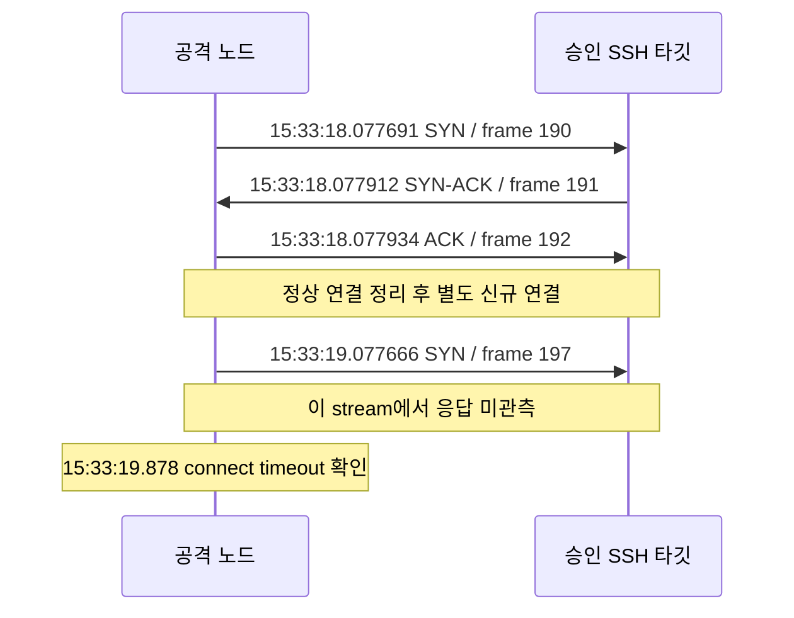

# [P4-3] 최종 쇼케이스 실측 증거 및 시연 가이드 — Draft

- Notion Task: https://notion.so/3fe04d37c225800cb3f3c3e103e72e32
- GitHub Issue: https://github.com/mmmphyun/aleph-project/issues/215
- 브랜치: `docs/network-p4-3-final-showcase-verification`
- 실제 작성일·실측일: **2026-10-23 KST**. 파일명의 `2026-10-25`는 Notion 산출물 명세이며 실측일이 아니다.
- 상태: **SSH 실패 2회 보존, 3차 신규 TCP 연결 무응답·동일 사건 두 Slack 게시 대조 완료. 최종 왕복 검증은 미완료.**

## 1. 목적과 현재 완료 범위

기존 통합 러너로 수행한 SSH 실측을 클라우드 B의 서버/CW·Slack 증거와 연결한다. 신규 TCP 연결 관측, 제어 처리의 성공 보고, 사후 분석·알림, 복구를 각각 평가한다. 로컬 러너 종료 코드 0은 전체 파이프라인 성공을 뜻하지 않는다.

| 카드 완료 조건 | 현재 증거와 판정 |
| --- | --- |
| SSH·Web 공격 → 차단 → 두 알림 → 복구의 최종 시나리오 | SSH 3차의 차단 후보·두 게시 확인. 이번 최종 리허설의 Web은 미실행, 3차 이후 복구 통신은 미확인 |
| 3회 연속 성공 | **미충족**. SSH 1·2차는 실패이며 3차도 최종 복구까지 검증하지 않았다 |
| 복구 무결성·멱등성 | 회차 사이 단일 TCP 재연결 2건 확보. 구성 원복·재실행 멱등성을 대신하지 않음 |
| 터미널·Slack·AWS 콘솔 3분할 가이드 | 9절에 작성. 기대 절차와 실제 확보 화면·결과를 구분 |
| 필수 품질 게이트 | 11절에 현재 변경의 실행 결과 기록 |

카드는 “최종 데모 시나리오 3회 연속 성공”의 판정 단위를 정의하지 않는다. **SSH 왕복과 Web 왕복을 모두 완료한 묶음 1회 × 연속 3회**를 제안하되, 추가 실행 전 사용자·담당자 합의가 필요하다. 이번 SSH 3개 회차를 연속 성공 3회로 세거나 실패를 제외해 성공률을 만들지 않는다.

## 2. 선행 작업과 소유권

| 선행 작업 | 읽기 전용으로 확인한 완료 근거 | 이번 문서의 적용 범위 |
| --- | --- | --- |
| P4-1 | Notion 완료, [PR #212](https://github.com/mmmphyun/aleph-project/pull/212) 머지 `ef9503500416b36d4b366b2fc814c929ec4cecf3` | [A의 배포/E2E 보고서](../cloud-a/2026-10-23-p4-1-eventbridge-llm-deployment-report.md) 인용. 네트워크가 배포 API 원본을 독립 검증한 것은 아님 |
| P4-2 | Notion 완료, [PR #214](https://github.com/mmmphyun/aleph-project/pull/214) 2026-10-23 15:57:39 KST 머지 | [B의 실측 보고서](../cloud-b/2026-10-23-p4-2-slack-sequential-measurement.md), 회차별 선별 로그·Slack 응답 사용 |
| P4-3 착수 | 열린 PR 0건, 중복 이슈/지정 브랜치 PR 없음 확인 후 표준 `get_my_tasks.py`의 `[착수 가능]` 확인 | main 최신화 → 이슈 #215 → 지정 브랜치 순서 준수. 앞선 공격은 P4-2 공동 실측 지원으로 수행 |

P4-1 보고서의 날짜 표기만으로 실제 배포 시각을 확정하지 않는다. P4-2 Notion 산출물 예시 파일명과 실제 머지된 보고서 파일명이 달라 위 실제 경로를 참조했다. Notion 상태·속성은 에이전트가 직접 변경하지 않았다.

네트워크는 공격 도구·캡처·오프라인 분석을 맡았다. A는 IAM 수정·배포 확인 및 SG/WAF 복구를, B는 수집·Slack 관측을 담당했다. `restore_baseline_sg.py`, `unblock_waf_ip.py`, AWS 변경·복구 API 및 Terraform은 네트워크가 실행하지 않았다. 이 PR은 네트워크 문서만 변경한다.

## 3. 승인 환경·버전·실행 상한

실행 당시 사용자가 전달한 A의 현재 테스트 계정·리전·대상·출발지 허용·복구 준비와 B의 관측 준비를 근거로 시작했다. 과거 모바일 주소나 일회용 노드 승인을 재사용하지 않았다. 아래 주소·리소스 표시는 공개 문서용 별칭이며 실제 값은 비공개 승인·계측 원본과 B 증거로 대조했다.

| 항목 | 당시 확인 범위 |
| --- | --- |
| 환경 | 승인된 단일 AWS 테스트 환경, `ap-southeast-2` |
| 공격 노드 | `ATTACKER_PUBLIC_IP`, Ubuntu 22.04.5 LTS, 인터페이스 `ens5`. 실행 직전 외부 조회 주소와 승인 주소 일치 확인 |
| 타깃 | `TARGET_INSTANCE_ID` / `TARGET_EC2_PUBLIC_IP`: TCP 22. Web용 `APPROVED_ALB_HTTP_ORIGIN`: HTTP 80은 승인됐으나 이번 회차 미실행 |
| 계정 | B가 준비 완료를 확인한 `cloudshield_test`, 합성 오답만 사용 |
| 실행 도구 | 별도 Python 3.12.15 환경, Hydra 9.2의 SSH·`-K` 호환 검사 통과, tcpdump 4.99.1, TShark 3.6.2 |
| 준비 변경 | 공격 노드에 도구 설치 및 tcpdump raw-packet 권한 준비. 원본 키는 보존하고 인코딩만 보정한 소유자 전용 임시 사본을 사용 후 삭제 |
| 배포 버전 | A가 main `ef95035` 배포와 후속 IAM 수정을 통보. 각 실행의 Lambda CodeSha256·IAM 정책 버전은 미확보이므로 현재 소스와 동일 배포임을 독립 확정하지 않음 |
| 문서 대조 기준 | P4-2를 포함한 main `adfc5b6e3a36ee43a93b6fc26c47e307351c22e8` |

기존 [통합 러너](demo-attack-runner.md), [SSH 계측 코드](../../../network/ec2_hydra_measurement.py), [WAF 계측](waf-packet-measurement.md)의 경계를 유지했다. 러너·분석기·테스트 및 이전 P2 권장 사항은 변경하지 않았다.

| 실행 요소 | 적용한 기존 상한 |
| --- | --- |
| SSH 공격 | 회차별 러너 1회, 합성 오답 5개, 동시성 1, 응답 대기 10초, 공격 최대 60초 |
| SSH 탐침 | 최대 60회, 약 1초 슬롯, connect timeout 0.8초. timeout은 서버 인증 실패 건수가 아님 |
| SSH 캡처 | 단일 대상 TCP 22, 75초·2,000패킷. 준비·생존을 확인한 뒤 공격 |
| 복구 확인 | 별도 10초·1,000패킷 캡처 아래 단일 TCP 연결 1회씩 |
| Web 계획 | 후보 GET 15개, 동시성 1, 응답 후 간격 1초, 요청당 3초·전체 60초, 별도 HEAD 최대 60회. **이번 미실행** |

캡처 시간 상한에 따른 하위 도구 코드 124는 이 SSH 계측기의 예상 종료 계약이다. 세 회차 모두 캡처가 상한 전에 종료하지 않았고 러너는 코드 0으로 끝났다. 각 회차는 새 ID·디렉터리·승인 기록을 사용했다. 2·3차는 A의 수정 및 사용자 전달 재실측 요청을 받은 별도 실행이며 자동 재공격이 아니다.

실행 파일 SHA-256은 배치 후와 실행 전에 동일함을 확인했다. 전체 7개 파일 목록은 비공개 사전 점검 기록에 있으며 주요 진입점은 다음과 같다.

| 파일 | SHA-256 |
| --- | --- |
| `demo_attack_runner.sh` | `d729d588169134608ed7b667b7e0d8abbd85615a6a01a3a26b0be1004a39759c` |
| `demo_attack_runner.py` | `f3a9a50d11aea49a7bab5bf9d2beb3ae5a3b769ee454de190c9cc910483b799d` |
| `ec2_hydra_measurement.py` | `20ce07f82f80585e35999e9026ba77ee1a4ea36a2d672c8c9f36b71e714ecf65` |
| `web_dir_scan.sh` | `14dca86ccb4310b11fbe4c2685f0497c2933a06708f35e2cf98ccf339a9aacd6` |

## 4. 회차와 사건 연결

모든 실제 실행은 **2026-10-23 KST**, SSH 시나리오다. Hydra는 모두 `exhausted_without_success`였고 B의 회차별 선별 CW 로그에서도 동일 출발지·계정의 실패 5건을 확인했다. 클라이언트 후보 수와 서버 실패 수는 각각의 증거로 확인했다.

| 회차 | 통합 러너 실행 ID | SSH 하위 ID | 사건 ID | 연결 성공 / timeout | 판정 |
| --- | --- | --- | --- | --- | --- |
| N1 / 14:27 | `20261023T052701Z-4d32bf15b23a` | `20261023T052701Z-fc08bb0a` | `INC-1792733237-1206` | 20 / 40 | L4 무응답 관측. B 로그상 WAF 권한 오류·필수 조치 미완료, 2차 미확보 |
| N2 / 14:40 | `20261023T054001Z-9afc91098a1f` | `20261023T054001Z-4d99eecc` | `INC-1792734015-1206` | 17 / 43 | 같은 WAF 오류 재발. 2차 미확보 |
| N3 / 15:33 | `20261023T063300Z-2e678558eefd` | `20261023T063301Z-a40d9186` | `INC-1792737195-1206` | 18 / 42 | L4 무응답·동일 사건 두 Slack 게시 확인. 최종 복구·Web·연속 성공은 미완료 |

N1/N2의 실패 원인은 B의 [1차 로그](../cloud-b/evidence/p4-2-2026-10-23/attempt1-logs.json)·[2차 로그](../cloud-b/evidence/p4-2-2026-10-23/attempt2-logs.json)의 `GetWebACLForResource` 권한 거부·필수 조치 미완료다. A는 IAM 수정·시뮬레이션 allowed·후속 실행 준비를 통보했다. 수정의 정확한 적용 시각·정책 버전·실제 principal 전체는 미확보이며, 시뮬레이션 통보를 과거 실패 회차의 성공으로 대체하지 않는다.

| 회차 | 1차 Slack 원본 ts | 2차 Slack 원본 ts |
| --- | --- | --- |
| N1 | `1792733240.770759` | 미확보 |
| N2 | `1792734019.129139` | 미확보 |
| N3 | `1792737198.950659` | `1792737202.531579` |

N3의 [Slack 응답](../cloud-b/evidence/p4-2-2026-10-23/attempt3-slack.json)에서 동일 사건·출발지·대상·계정을 대조했다. 1차 카드는 L4 격리·L7 IPSet 완료를 보고하며 IAM은 SSH 시나리오 미대상이다. 이는 집행 결과 보고이고, 이번 PCAP은 L4 신규 연결 관측이다. **SSH 카드만으로 ALB 데이터 경로의 HTTP 차단까지 독립 실측했다고 쓰지 않는다.**

## 5. 실제 타임라인과 시간 계산

### 5.1 사건의 시작·끝 구분

| 사건 / KST | N1 | N2 | N3 |
| --- | --- | --- | --- |
| 러너 호출 | 14:27:00.680 | 14:40:00.678 | 15:33:00.652 |
| 공격 전 TCP 연결 완료 | 14:27:01.109 | 14:40:01.481 | 15:33:01.076 |
| Hydra 호출 경계 | 14:27:01.110 | 14:40:01.482 | 15:33:01.076 |
| 공격 흐름 첫 SYN | 14:27:01.132802 | 14:40:01.521191 | 15:33:01.096984 |
| 다섯 번째 실패의 CW event timestamp | 14:27:15.059 | 14:40:13.574 | 15:33:14.566 |
| 해당 실패 CW ingestionTime | 14:27:17.338 | 14:40:15.596 | 15:33:15.258 |
| 마지막 정상 탐침 SYN | 14:27:20.111526 | 14:40:17.483182 | 15:33:18.077691 |
| 첫 무응답 탐침 SYN | 14:27:21.111517 | 14:40:18.483217 | 15:33:19.077666 |
| 첫 timeout 결과 확인 | 14:27:21.912 | 14:40:19.284 | 15:33:19.878 |
| 1차 Slack 게시 | 14:27:20.770759 | 14:40:19.129139 | 15:33:18.950659 |
| 2차 Slack 게시 | 미확보 | 미확보 | 15:33:22.531579 |
| 로컬 러너 종료 | 14:28:16.658 | 14:41:16.714 | 15:34:16.687 |

공격 흐름은 TCP 탐침과 구분해 클라이언트 payload가 있는 SSH stream의 SYN을 선택했다. PCAP의 SYN 시각, 클라이언트 timeout 확인 시각, Hydra 종료 확인 시각은 서로 다르다. 계측기는 탐침을 마친 뒤 Hydra 종료를 확인하므로 그 확인 시각으로 도구의 정확한 실행 시간을 역산하지 않는다.

CW `timestamp`와 `ingestionTime`은 정수 밀리초다. N3 다섯 번째 실패의 메시지 자체에는 `06:33:14.566722+0000`도 보존돼 있으나 아래 계산은 B와 일치하도록 **CW timestamp `1792737194566` 기준**을 명시해 사용했다. 사건 ID의 숫자를 탐지 판정 시각으로 사용하지 않는다.

공격 노드의 NTP 동기화는 확인했지만 서버·AWS·Slack·클라이언트 간 시계 오차의 수치는 미측정이다. PCAP은 마이크로초, 러너는 밀리초, Slack ts는 소수 6자리 원문을 유지했다. UTC 원본과 KST(UTC+09:00)를 연결했으며 계산 자릿수는 절대 정확도 보장이 아니다.

### 5.2 N3 서버·비동기 실행 대조

[N3 선별 로그](../cloud-b/evidence/p4-2-2026-10-23/attempt3-logs.json)의 관련 Orchestrator RequestId는 `82936d2a-940a-4d93-9048-0728ffe2a5d0`, Analyzer RequestId는 `389fa871-0ea7-4755-a1d4-3b2bc0124e43`다.

| 관측 | KST / 내용 | 증거의 한계 |
| --- | --- | --- |
| Orchestrator START → END | 15:33:15.384 → 15:33:19.279, REPORT Duration 3894.59ms | 정확한 탐지 판정·개별 차단 API 완료 시각은 아님 |
| 1차 게시 | ts `1792737198.950659` | Slack 서버 게시이며 발송 HTTP 응답·사용자 수신과 구분 |
| 마지막 정상 → 첫 무응답 SYN | 15:33:18.077691 → 15:33:19.077666 | 약 1초 표본 공백. 정확한 SG 정책 적용 순간으로 확정하지 않음 |
| Analyzer START → END | 15:33:20.472 → 15:33:22.653, REPORT Duration 2179.64ms | 전체 워커 실행 시간이며 Bedrock API RTT가 아님 |
| 2차 게시 | ts `1792737202.531579` | 동일 사건의 분석 카드 게시. 추가 차단 집행 증거는 아님 |

두 REPORT의 X-Ray TraceId `1-6adaffab-5a412f945191e59d4226f1cb`가 일치한다. 선택 런타임 로그 자체에 incident_id·EventBridge 발행 성공·Bedrock 요청/응답 구간은 없어, 시간대·trace·Slack 사건 연결을 함께 사용한다. 조회된 Analyzer 실행과 분석 카드 내용은 확인되지만 API 응답 원문·`llm_analyzed` 결과가 없어 정상 추론/fallback의 독립 판정을 과장하지 않는다. 로그 선택 범위에 ERROR/WARNING이 없다는 사실만으로 모든 외부 호출 성공을 증명하지 않는다.

### 5.3 분리해서 계산한 지연

`T_syn`은 공격 흐름 첫 SYN, `T_auth5`는 다섯 번째 실패의 CW timestamp, `T_cut`은 첫 무응답 탐침 SYN, `T_s1/T_s2`는 Slack 게시 ts다. Decimal로 원본 epoch를 계산했다.

| 지표 / 초 | N1 | N2 | N3 |
| --- | --- | --- | --- |
| `T_cut - T_syn` | 19.978715 | 16.962026 | 17.980682 |
| `T_cut - T_auth5` | 6.052517 | 4.909217 | 4.511666 |
| `T_s1 - T_syn` | 19.637957 | 17.607948 | 17.853675 |
| `T_s1 - T_auth5` | 5.711759 | 5.555139 | 4.384659 |
| `T_s2 - T_syn` | 미계산 | 미계산 | 21.434595 |
| `T_s2 - T_auth5` | 미계산 | 미계산 | 7.965579 |
| `T_s2 - T_s1` | 미계산 | 미계산 | **3.580920** |

N3의 `T_cut - T_auth5`는 기록값 기준 10초 이내이지만 첫 SYN 기준은 10초를 초과한다. 서버 실패 조건 관련 사건과 실제 Lambda 탐지 판정을 구분하며, 누락된 WAF API 시각·정확한 정책 효력·복구까지 포함한 전체 10초 SLA를 확정하지 않는다. N1/N2의 일부 지표가 10초 이내여도 필수 WAF 조치가 실패했으므로 전체 성공이 아니다.

두 카드 간 3.580920초는 **게시 간격**이다. 사용자 수신 지연 또는 Bedrock 추론 RTT로 부르지 않는다. 과거 L4 5.48초·WAF 18.2초는 이번 계산에 재사용하지 않았다.

## 6. L4 TCP 패킷 분석과 L7 경계

| 회차 | 패킷 / stream | SYN / SYN-ACK / FIN / RST | tcpdump 수신·커널 드롭 |
| --- | --- | --- | --- |
| N1 | 249 / 63 | 63 / 23 / 26 / 21 | 249 / 0 |
| N2 | 233 / 63 | 63 / 20 / 24 / 20 | 233 / 0 |
| N3 | 238 / 63 | 63 / 21 / 24 / 20 | 238 / 0 |

위 카운터는 캡처 범위의 관측값이다. 커널 드롭 0을 전체 경로 무손실 보장으로 확대하지 않는다. 서버 배너를 받는 짧은 탐침과 Hydra의 연결이 함께 포함돼 TCP stream 수가 인증 실패 수와 같지 않다.

N3의 마지막 정상 탐침은 stream 20, 첫 무응답 탐침은 별도 stream 21이다.

| frame / stream | KST | 방향·플래그 | 상대 seq / ack | 해석 |
| --- | --- | --- | --- | --- |
| 190 / 20 | 15:33:18.077691 | 공격 노드 → 타깃 SYN | 0 / 0 | 신규 연결 시작 |
| 191 / 20 | 15:33:18.077912 | 타깃 → 공격 노드 SYN, ACK | 0 / 1 | 연결 응답 |
| 192 / 20 | 15:33:18.077934 | 공격 노드 → 타깃 ACK | 1 / 1 | 3-Way Handshake 확인 |
| 193 / 20 | 15:33:18.077966 | 공격 노드 → 타깃 FIN, ACK | 1 / 1 | 클라이언트 측 연결 정리 |
| 196 / 20 | 15:33:18.088529 | 공격 노드 → 타깃 RST | 2 / 0 | 앞 정상 연결의 정리 흔적. 차단 RST로 분류하지 않음 |
| 197 / 21 | 15:33:19.077666 | 공격 노드 → 타깃 SYN | 0 / 0 | 이 stream의 응답 패킷 미관측 |

암호화된 SSH payload에서 실패 5회를 읽어낸 것이 아니다. B가 보존한 `Failed password` 5건의 출발지·계정과 별도로 대조했다. 이번 결과는 신규 연결 무응답이며 이미 인증된 Established 세션 종료를 검증한 것이 아니다. SG 원인·부착 상태는 A의 구성 증거와 구분한다.

**이번 P4 최종 리허설의 Web 요청·HTTP 403·WAF BLOCK 시퀀스는 미확보다.** Web 러너 자체는 PCAP을 생성하지 않는다. 향후 Web은 별도 승인된 캡처에서 요청별 HTTP 상태·TCP handshake·종료를 확인하고, B/보안이 WAF 원본의 clientIp·URI·시각·terminatingRuleId와 대조해야 한다. [이전 WAF 403 보고서](2026-10-16-p3-6-waf-403-retest.md)는 별도 과거 실행의 참고이며 이번 왕복 결과에 합치지 않는다.

## 7. 복구: 구성·통신·멱등성 구분

| 확인 | 네트워크 직접 관측 | 아직 필요한 근거 |
| --- | --- | --- |
| N1 후, N2 전 | 14:37:12.451~14:37:12.460 단일 TCP 연결 성공. 별도 7패킷의 SYN/SYN-ACK/ACK 확인 | 정확한 SG 부착 목록·WAF 원복 및 API 완료 시각, 복구 재실행 결과 |
| N2 후, N3 전 | 15:30:44.326~15:30:44.336 단일 TCP 연결 성공. 별도 7패킷의 handshake 확인 | 같은 구성 원복·재실행 근거 |
| N3 후 | 이번 증거에서 미확인 | A의 SG/WAF 복구 완료 통보·구성 결과, 승인된 최소 TCP·HTTP 탐침과 캡처 |

회차 사이 A는 정상 가동·출발지 허용·WAF 클린 또는 수정 완료를 통보했다. 네트워크는 이후 제한된 단일 연결로 통신 회복을 확인했다. 구성 복구 완료 시각·통신을 처음 관측한 시각·복구 멱등성은 각각 별개다. 두 재연결 사이의 시간을 복구 처리 시간으로 계산하지 않는다.

복구 멱등성은 A가 승인 범위에서 동일 원복을 재실행했을 때의 결과·구성 불변 근거가 필요하다. 재연결 한 번이나 “멱등하게 복구 가능”이라는 준비 통보로 검증 완료를 표시하지 않는다.

## 8. 남은 회차 설계와 중단 조건

아래는 **추가 실행 전 합의할 계획**이며 이번 문서/PR 작업에서 새 공격·탐침·복구를 실행하지 않는다.

1. 사용자와 “3회 연속” 단위를 확정하고 회차·시간대·상한을 승인받는다. 대상·출발지·승인 유효기간·배포 버전·테스트 계정과 A/B/보안의 준비를 다시 확인한다.
2. SSH는 기존 상한을 유지한다. 캡처 준비·생존·저장 확인과 정상 TCP baseline 후 1회 실행한다. B는 같은 사건 두 카드, A는 차단·워커 증거, 보안은 입력·룰 대응을 확인한다.
3. A의 SG/WAF 복구 완료 후 새 복구 캡처 아래 최소 탐침으로 통신을 확인한다. 지연 이벤트·잔존 윈도우의 다음 회차 영향을 A/B와 확인하며, TTL 삭제만 기다렸다는 이유로 상태 초기화를 선언하지 않는다.
4. Web은 별도 캡처와 정상 HEAD 200을 확인한 뒤 기존 GET 15개·동시성 1·60초 상한을 유지한다. 별도 HEAD 관측과 공격 요청을 구분한다. 첫 403과 WAF 원본 BLOCK을 연결하고 원복 후 정상 HTTP를 확인한다.
5. 이전 회차 복구와 baseline 재확인 후 다음 묶음을 시작한다. 실패 회차는 보존하고 자동 재시도·승인 없는 추가 실행을 하지 않는다.

캡처 상한은 SSH 75초·2,000패킷을 유지한다. Web 별도 캡처 90초·2,000패킷·snaplen 4,096, 복구 확인 캡처 10초·1,000패킷·탐침 1회, 두 카드 관측은 첫 공격부터 최대 120초, A 복구 완료 통보 대기는 요청부터 120초를 제안한다. 이 추가 계획의 값은 승인 전 확정된 실행 결과가 아니다. 미확인된 통보 지연을 실제 플랫폼 실패 시각으로 대체하지 않는다.

대상·출발지·승인 불일치, 예상 밖 인증 성공, 캡처 조기 종료·저장 실패, 실행/관측 상한 초과, 복구 미확인·baseline 불일치, 담당자 중단 요청 시 멈춘다. 도구·탐지·차단·LLM·알림·복구 실패를 구분하고 담당자에게 연결한다. fallback 카드는 정상 추론 성공으로 집계하지 않는다.

## 9. 터미널·Slack·AWS 콘솔 3분할 시연 가이드

| 화면 | 조작 담당 | 보여줄 실제 증거·대기 지점 |
| --- | --- | --- |
| 왼쪽 터미널 | 네트워크 | 러너 dry-run, 승인된 실제 실행의 run_id·baseline·단계·남은 관측 시간. 원본 키·환경 변수 전체·Hydra 비공개 원문은 화면에 출력하지 않음 |
| 가운데 Slack | B | 동일 incident_id의 실제 1·2차 카드와 원본 ts. 1차 집행 보고, 2차 분석·권고를 구분하고 추가 집행으로 해석하지 않음 |
| 오른쪽 AWS 콘솔 | A | 배포 확인, 해당 Lambda/Analyzer 실행, SG/WAF 상태 및 원복 결과. AWS 콘솔 조작·복구 실행은 A가 담당 |

시연 순서는 준비 확인 → 캡처·baseline → 공격 → 실제 차단 후보·카드 대조 → A 복구 → 통신 회복 확인이다. SSH가 끝나도 두 카드·복구를 확인하기 전 Web으로 넘어가지 않는다. 중단 시 네트워크는 소유 공격·캡처 프로세스를 정리하고 원본을 보존하며, A가 복구하고 B가 마지막 사건 상태를 정리한다.

`dry-run`, `baseline`, `attack_started`, `first_block_candidate`, `end`는 기존 러너의 **표시 단계 예시**다. timeout/403 표시가 반드시 나올 것이라고 약속하지 않는다. `end` 코드 0 화면만으로 최종 성공을 발표하지 않는다. N3 두 카드·L4 패킷은 실제 확보한 자료이지만 3분할 동시 녹화·Web·최종 복구 화면은 이번에 확보하지 않았다. 이를 합성 화면이나 과거 실측으로 채우지 않는다.

## 10. 증거 보존·해시·출처

PCAP·Hydra 원문·승인 파일·manifest·헤더·개인키는 Git에 추가하지 않았다. 공개 본문은 현재 공인 IP·계정 ID·전체 ARN·인스턴스 식별자를 별칭으로 표시한다. run_id·incident_id·RequestId는 원본 사건 연결에 사용한다. B의 기존 선별 증거는 읽기 전용으로 참조하며 다른 직무 파일은 수정하지 않는다.

### 10.1 Git 밖 네트워크 증거

아래는 로컬 보존 위치 설명이며 저장소 상대 링크가 아니다. 공통 로컬 접두어는 `%USERPROFILE%\CloudShieldEvidence\`다. 원격은 승인 공격 노드의 `/home/ubuntu/` 아래 같은 remote-root 이름이다. 디렉터리는 소유자 전용이며 원본을 덮어쓰지 않았다.

| 회차 | 로컬 root / 그 안의 remote-root | PCAP 상대 경로 | 보존 manifest의 검증 파일 수 |
| --- | --- | --- | --- |
| N1 | `p4-joint-20261023T052700Z/cloudshield-p4-joint-20261023T052700Z` | `runs/20261023T052701Z-4d32bf15b23a/ssh/20261023T052701Z-fc08bb0a/capture.pcap` | 14 |
| N2 | `p4-joint-retest-20261023T054000Z/cloudshield-p4-joint-retest-20261023T054000Z` | `runs/20261023T054001Z-9afc91098a1f/ssh/20261023T054001Z-4d99eecc/capture.pcap` | 16 |
| N3 | `p4-joint-third-20261023T063300Z/cloudshield-p4-joint-third-20261023T063300Z` | `runs/20261023T063300Z-2e678558eefd/ssh/20261023T063301Z-a40d9186/capture.pcap` | 21 |

검증 수에는 원본·계측·파생 파일이 함께 포함된다. `ssh-preservation-manifest.private.json`은 회차 종료 당시의 스냅샷이며 이후 추가한 A/B 전달 기록은 별도 파일이다. N1 복구 증거는 `updates-after-iam-fix/recovery-check-before-ssh-retest/`, N2 이후 연결 확인은 N3 root의 `recovery-baseline-before-third/`에 있다. 원본 manifest와 이후 전달 기록을 같은 시점의 AWS 원본으로 취급하지 않는다.

| 증거 | SHA-256 |
| --- | --- |
| N1 `capture.pcap` | `a619f5d16bf7c073e08c0e59f92a12ac2e7fa5b14b16e22575032de17b6e1a8c` |
| N2 `capture.pcap` | `898d02efd03f0ecf9a039ce5d03acb4bb1cec5ae3c04714227a11454fb03290e` |
| N3 `capture.pcap` | `f248368781f68749a80094d66059ee5eea2aa8ce238185938396482d08b8266f` |
| N1 SSH `manifest.private.json` | `d3f7e16a11843c085351796ffe5ad88a678c297bd29023dc9970077bdf291420` |
| N2 SSH `manifest.private.json` | `08e6f7a943d32f59a78278a7fb944c95d44dafc536280ab121566cfed2016775` |
| N3 SSH `manifest.private.json` | `f4bca6894d2193629a7eb5bf08b5858317d3fc5ab168e15eb99682c07422597a` |
| N1 이후 복구 확인 PCAP | `58f121d6f4e4df7fa8b6b1e83a64f33590f124003c9037f84500d8c83865bb7b` |
| N2 이후 복구 확인 PCAP | `d239be72302c8ce5adfa81caf1cd8a2b3141a6a585f961a534a730828801faaa` |

### 10.2 B의 공개 선별 증거와 출처 경계

| 파일 | 기준 커밋 Git blob 바이트의 SHA-256 |
| --- | --- |
| [N1 로그](../cloud-b/evidence/p4-2-2026-10-23/attempt1-logs.json) | `8ea8293f461b508f9156d7ee4875b1ebbc59058f7f6b6e27966dc5e4bdb93cb3` |
| [N1 Slack](../cloud-b/evidence/p4-2-2026-10-23/attempt1-slack.json) | `30df4763efeb2dee897a67592e8bc0cb8f1685219d961ca4981f2e74a434ea6b` |
| [N2 로그](../cloud-b/evidence/p4-2-2026-10-23/attempt2-logs.json) | `90d2a0d4cc5aa12eac246b8de6ac1bd86c3bd93ed91132ed2f13fc3f01410f6f` |
| [N2 Slack](../cloud-b/evidence/p4-2-2026-10-23/attempt2-slack.json) | `aa63c25db4488bb6f7e5e410075e27bee7fe6b5eccff420f66280fe433f1b727` |
| [N3 로그](../cloud-b/evidence/p4-2-2026-10-23/attempt3-logs.json) | `5223b4ed78bceb65350066712bdb327efe035c4179a7c6ea26a302ca3445edd8` |
| [N3 Slack](../cloud-b/evidence/p4-2-2026-10-23/attempt3-slack.json) | `3c91d0ac2610f135171d9f5aaf388c10399497db605fff23274378497f14db4a` |
| [B 출처 manifest](../cloud-b/evidence/p4-2-2026-10-23/manifest.json) | `6ef3eeadd19c31d0f0bd275e0a09324fbef29d7a018e6f8d739cb1875a80e6bf` |

표는 기준 커밋 `adfc5b6`의 Git blob을 직접 읽어 계산했다. Windows 체크아웃의 CRLF 변환에 따라 작업 파일 해시가 달라질 수 있어 저장소의 LF 바이트를 기준으로 고정했다.

B manifest의 `source_sha256`는 B가 보존한 전체 수신 원본의 출처 기록이다. 로그는 선별·마스킹으로 해시가 달라질 수 있고 Slack 응답은 원문 보존으로 일치할 수 있다. 네트워크가 전체 AWS 응답을 새로 확보·재해시했다는 뜻은 아니다. 선택 필드·마스킹·조회 범위의 한계를 유지한다. 해시 일치는 보존·파일 식별의 근거이지 AWS 출처의 독립 인증은 아니다.

## 11. 검증 기록과 인계 조건

- 비공개 N1/N2/N3 보존 manifest의 14/16/21개 파일, 두 복구 PCAP 및 관련 CSV·로그 해시를 대조했다. 기존 원본·사용자 문서를 보존했다.
- B의 세 회차 로그·Slack 응답을 사건 ID·출발지·대상·계정과 연결하고 UTC/KST·Decimal 시간 차·패킷 frame/stream 순서를 재계산했다.
- 로컬 종료 코드 0과 필수 WAF 조치 실패, 게시 간격과 Bedrock RTT, 구성 복구와 통신 회복·멱등성을 구분했다.
- 문서 상대 링크·표·코드펜스·마스킹, 15개 Decimal 시간 차, 사건·카드·해시 연결 및 기존 사용자 파일 보존 검증을 통과했다.
- 필수 명령 `powershell .\scripts\check.ps1`: 원 작업 폴더에서는 R&R 통과 후 기존 `.pytest_cache`의 접근 권한 오류로 경로 순회가 중단됐다. 캐시·검증 스크립트를 변경하지 않고 동일 main `adfc5b6`의 관리 작업 폴더에 문서 두 개를 적용해 **같은 명령을 우회 플래그 없이 실행·통과**했다. 역할은 `AGENT_ROLE=network`, Python 3.12.14, 의존성은 `uv sync --all-extras --locked` 기준이다.
- 분리 검증 결과: R&R·테스트 경로·Ruff lint 통과, Ruff format 158개 파일 통과, pytest **1309 passed / 4 skipped / 1 warning, 197.45초**. skip은 Terraform/provider 준비가 필요한 기존 WAF 2건·네트워크 모듈 2건이며, warning은 기본 소켓 차단을 확인하는 기존 smoke 테스트에서 발생했다. IaC mock 검증까지 실행했다고 확대하지 않으며 원격 CI 결과는 별도 확인한다.
- 문서만 변경하며 신규 런타임·저장소·분산 윈도우 구현은 없다. 신규 코드용 카오스 테스트 추가 대상은 아니며 기존 게이트·테스트·제약은 유지한다.

Draft 해제 전에는 3회 연속 판정 단위 합의, Web 실제 요청·별도 PCAP·WAF 원본 대조, A의 구성 원복·재실행 결과, N3 이후 및 각 후속 회차의 정상 통신 회복, 정상 분석/fallback 판정 근거를 보완해야 한다. 3차 SSH의 두 게시 확인을 전체 최종 시나리오 완료로 표시하지 않는다. 별도 요청 전 머지하지 않는다.
